# ASIAIR Remote Transfer

**Снимки с ASIAIR из удалённой обсерватории — сами у вас дома.** Две небольшие программы забирают новые кадры с ASIAIR и передают их через интернет на домашний компьютер, а в браузере показывают, что снято за ночь: FITS с авторастяжкой, оценку кадров, сводку по ночам. Лишнее можно удалить прямо на ASIAIR, не подключаясь к обсерватории. Третья программа, по желанию, раскладывает полученные кадры для обработки в Siril.

[](https://github.com/arbalet1985/asiair_transmit_photo/releases/latest)


[](LICENSE)

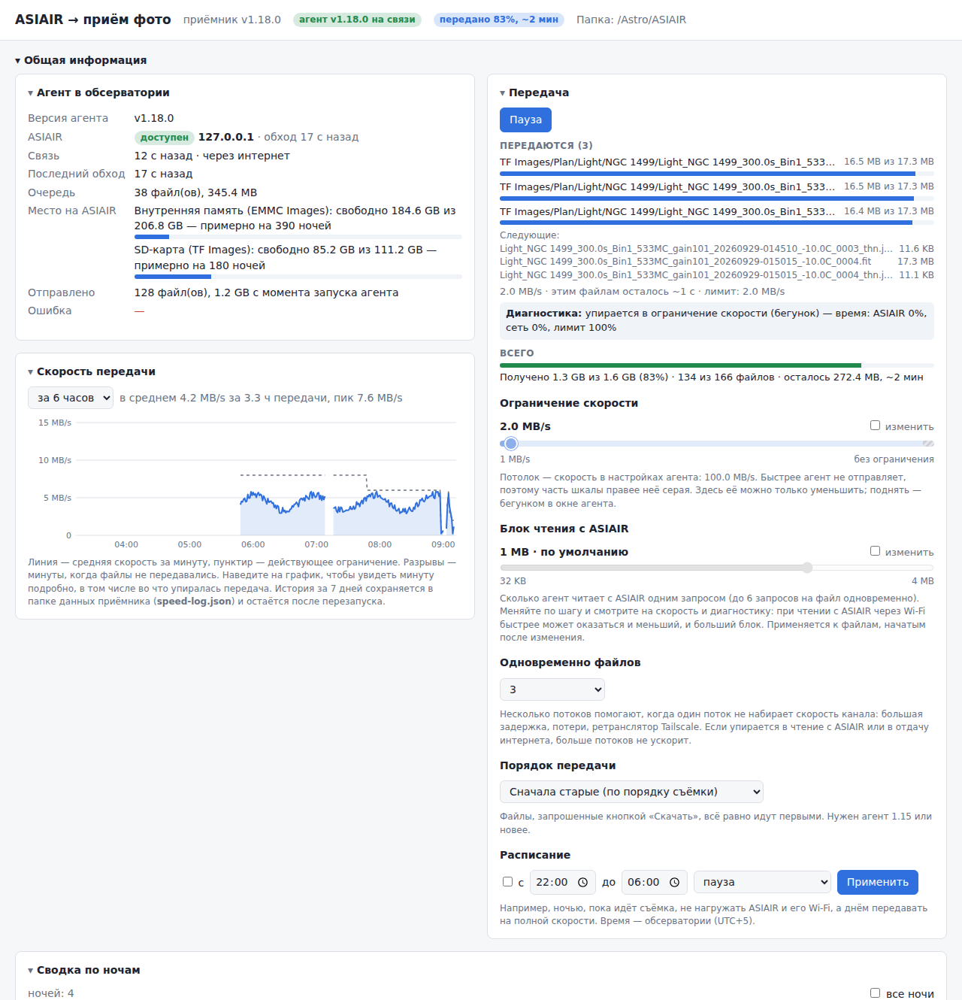

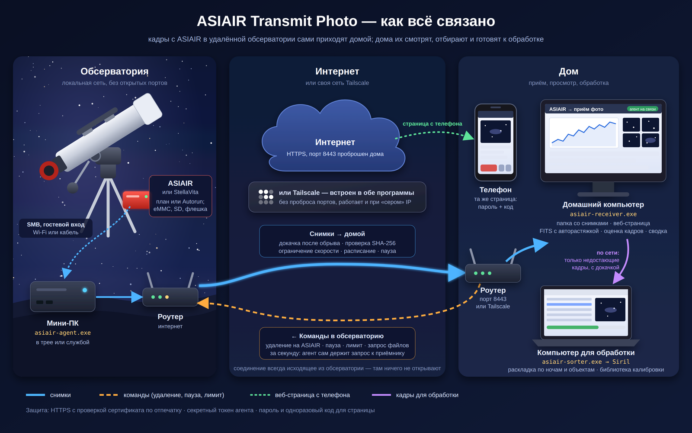

* **Агент** (`asiair-agent.exe`) работает на Windows-ПК в той же сети, что и ASIAIR. Он забирает новые снимки и отправляет их домой. Соединение всегда исходящее: в обсерватории не нужно открывать порты.
* **Приёмник** (`asiair-receiver.exe`) работает на домашнем компьютере. Он складывает снимки в папку и показывает веб-страницу, которую можно открыть и с телефона.
* **Связь** — на выбор: через интернет (на домашнем роутере открыт порт) или через **Tailscale**, встроенный в обе программы: ничего не нужно открывать, работает и при «сером» IP, бесплатно.
* **Телефон** открывает ту же страницу приёмника (пароль и, по желанию, одноразовый код), а **сортировщик** (`asiair-sorter.exe`) на компьютере для обработки забирает кадры с приёмника по сети и раскладывает их для Siril.

> **In English.** ASIAIR Remote Transfer moves the frames from a ZWO ASIAIR in a remote observatory to your home computer over the internet: an agent next to the ASIAIR reads its SMB shares and uploads new files (resumable, SHA-256 verified, rate-limited), a receiver at home stores them and serves a web page — FITS viewer with auto-stretch, frame quality (stars, HFR), per-night summary, remote deletion on the ASIAIR, phone access. A third program, the sorter, lays the frames out for Siril (sessions by object and night, a calibration library) — from a folder or from the receiver over the network. Works through a port forward or the built-in Tailscale. Windows programs, interface in Russian.

## Содержание

1. [Возможности](#возможности)
2. [Что понадобится](#что-понадобится)
3. [Установка](#установка)
4. [Первая настройка](#первая-настройка)
   * [Шаг 1. Домашний компьютер: приёмник](#шаг-1-домашний-компьютер-приёмник)
   * [Шаг 2. Связь: интернет или Tailscale](#шаг-2-связь-интернет-или-tailscale)
   * [Шаг 3. ПК в обсерватории: агент](#шаг-3-пк-в-обсерватории-агент)
   * [Проверка, что всё работает](#проверка-что-всё-работает)
5. [Повседневная работа](#повседневная-работа)
   * [Окно агента](#окно-агента)
   * [Страница приёмника](#страница-приёмника)
   * [Просмотр снимков](#просмотр-снимков)
   * [С телефона](#с-телефона)
   * [Значок приёмника в трее](#значок-приёмника-в-трее)
   * [Раскладка кадров для Siril](#раскладка-кадров-для-siril)
     * [Кадры с приёмника по сети](#кадры-с-приёмника-по-сети)
     * [Обработка в Siril](#обработка-в-siril)
     * [Планировщик ночи](#планировщик-ночи)
6. [Обновления](#обновления)
7. [Файлы настроек и команды](#файлы-настроек-и-команды)
8. [Частые проблемы](#частые-проблемы)
9. [Как это устроено](#как-это-устроено)
10. [Сборка, разработка, выпуск версий](#сборка-разработка-выпуск-версий)
11. [Лицензия и отказ от ответственности](#лицензия-и-отказ-от-ответственности)

## Возможности

**Передача**
* Все новые снимки (FITS, JPG, PNG, TIFF, XISF) из внутренней памяти ASIAIR, с SD-карты и с флешки. Структура папок (`EMMC Images/Autorun/Light/M 31/…`) и даты файлов сохраняются.
* Логин к ASIAIR не нужен: ASIAIR пускает гостя. Агент сам находит ASIAIR (и StellaVita) в сети и находит его снова, если у него сменился адрес.
* **Докачка** после обрыва связи с того же места, **проверка SHA-256** каждого файла. Недописанный кадр не уходит, пока файл меняется.
* **Скорость** ограничивается бегунком, несколько файлов могут идти одновременно, **диагностика** показывает, во что упирается передача: в чтение с ASIAIR, в сеть или в лимит.
* **Пауза, расписание, порядок:** например, ночью, пока идёт съёмка, пауза или не быстрее 2 MB/s; сначала новые кадры или сначала Light.
* **Выборочно:** на паузе можно скачать отдельные файлы или папку, а выбранные папки — синхронизировать, включая новые кадры в них.

**Просмотр и отбор**
* **FITS в браузере** с авторастяжкой как STF в PixInsight, дебайеризацией цветных кадров и увеличением до полного разрешения.
* **Оценка кадров:** приёмник сам находит звёзды на каждом Light-кадре и измеряет HFR; кадры с облаками или плохим фокусом помечаются ⚠.
* **Галерея** миниатюр, фильтры по ночи, объекту, типу кадра, Луне, качеству; сортировка по любому столбцу.
* **Удаление на ASIAIR** из дома: отдельные файлы, всё уже полученное или папка целиком. Автоочистка удаляет полученные и проверенные файлы старше N дней.

**Обзор**
* **Сводка по ночам:** сколько Light, Dark, Flat, Bias снято по каждому объекту, суммарная выдержка, фаза и высота Луны, медианный HFR.
* **График скорости** за час — 7 дней, **место** на ASIAIR (на сколько ночей хватит) и на домашнем диске.

**Удобство и безопасность**
* Всё настраивается мышкой: окно агента и веб-страница приёмника. Запуск вместе с Windows: значок в трее или служба.
* **С телефона** — та же страница с вёрсткой под телефон, вход по паролю и, по желанию, одноразовому коду.
* **Обновляются сами** с GitHub; агент при неудачном обновлении откатывается на прежнюю версию.
* HTTPS с проверкой сертификата по отпечатку и секретный токен. Страница приёмника по умолчанию открывается только на самом компьютере.

**Подготовка к обработке** (`asiair-sorter.exe`)
* **Раскладка для Siril:** лайты — по объекту и ночи в папки с `lights`, `darks`, `flats`, `biases`, как ждут скрипты Siril; дарки, биасы и флеты — в библиотеку по гейну, выдержке, температуре, фильтру.
* **Подбор калибровки** к каждой сессии, в том числе из библиотеки, собранной раньше.
* **Планировщик ночи:** горизонт и закрытые зоны (провода) угадываются по снятым кадрам и правятся мышкой; несколько объектов по приоритету с учётом перехода, фокусировки, дизеринга и перекладки через меридиан; план для ASIAIR и анимация движения телескопа с Луной.
* **С приёмника по сети** на другой компьютер: скачиваются только недостающие кадры, прерванное скачивание продолжается; кадры, удалённые на приёмнике, но оставшиеся в выходном каталоге, подсвечиваются по кнопке и удаляются по другой.

## Что понадобится

* **ASIAIR** (Plus, Pro, Mini и другие — с доступом к файлам по сети) или **StellaVita**, подключённый к сети обсерватории — по Wi-Fi или кабелем.
* **Компьютер с Windows 10 или 11 (64 бит) в обсерватории**, в той же сети, что и ASIAIR, с доступом в интернет. Подойдёт мини-ПК. Для Linux есть консольная версия агента.
* **Домашний компьютер с Windows 10 или 11** — на нём работает приёмник и хранятся снимки. Для Linux есть консольная версия приёмника.
* Интернет в обсерватории. Скорость передачи ограничена отдачей (upload) интернета обсерватории.
* Для связи — одно из двух: возможность пробросить порт на домашнем роутере (нужен «белый» IP) **или** бесплатная учётная запись Tailscale.

## Установка

Готовые программы лежат на странице **[Releases](https://github.com/arbalet1985/asiair_transmit_photo/releases/latest)**:

| Файл | Для чего |
|---|---|
| `asiair-agent.exe` | ПК в обсерватории |
| `asiair-receiver.exe` | домашний компьютер |
| `asiair-sorter.exe` | раскладка полученных кадров по папкам для Siril (необязательно) |
| `asiair-remote-transfer-…-windows.zip` | все три программы и примеры настроек одним архивом |
| `asiair-remote-transfer-…-linux-amd64.tar.gz` | консольные версии для Linux |

Установщика нет: каждая программа — один `.exe` без зависимостей. Положите его в отдельную папку, доступную для записи (например, `C:\ASIAIR-Agent\`; не в `C:\Program Files`), — там же программа хранит настройки и журнал.

> **«Windows защитила ваш компьютер».** Программы не подписаны цифровой подписью, поэтому при первом запуске скачанного файла SmartScreen может предупредить. Нажмите «Подробнее» → «Выполнить в любом случае» или заранее: правая кнопка по `.exe` → «Свойства» → «Разблокировать». Обновления программы ставят сами, и это окно для них не появляется.

Собрать программы из исходников — в разделе [Сборка](#сборка-разработка-выпуск-версий).

## Первая настройка

Порядок важен: сначала домашний компьютер, потому что агенту понадобятся токен и адрес приёмника.

### Шаг 1. Домашний компьютер: приёмник

1. Скопируйте `asiair-receiver.exe` в отдельную папку, например `C:\ASIAIR-Receiver\`, и запустите двойным щелчком.
2. Приёмник спрячется в трей (зелёный круглый значок-телескоп; у агента значок синий квадратный) и откроет в браузере страницу **http://127.0.0.1:8080**. При первом запуске он сам создаёт `receiver.yaml` со случайным токеном: у каждой установки токен свой.
3. На странице, в блоке «Настройки»:
   * **«Папка для снимков» → «Изменить…»** — выберите диск и папку, куда складывать снимки. Можно создать новую папку или вписать путь вручную.

     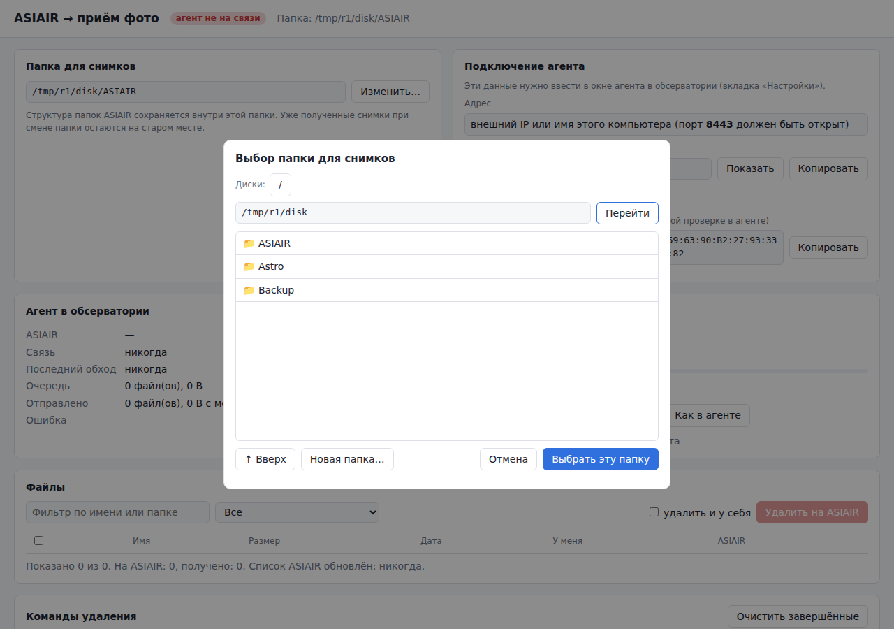

   * **«Запуск на этом компьютере»** — выберите одно из двух:
     * галочка **«Запускать при входе в Windows»** — приёмник стартует значком в трее, когда вы входите в систему. Права администратора не нужны;
     * кнопка **«Установить как службу Windows…»** — приёмник работает сразу после включения компьютера, даже если никто не вошёл. Windows попросит подтвердить права администратора. Кнопка «Удалить службу…» возвращает всё назад.

     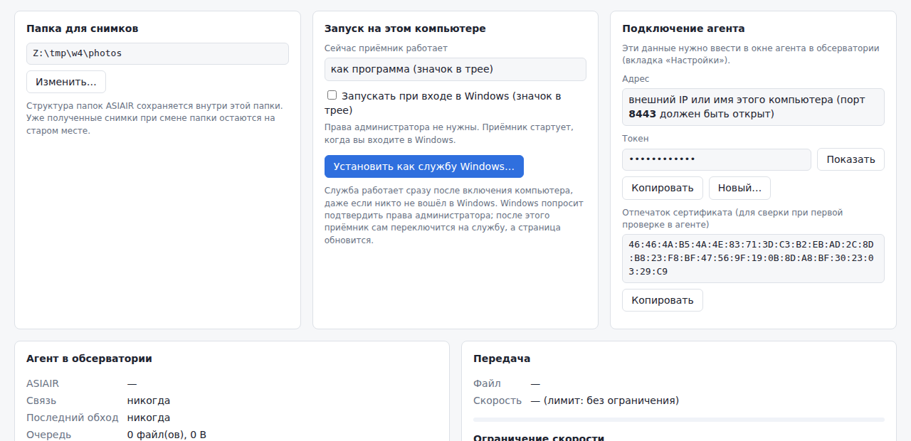

   * **«Подключение агента»** — здесь токен (кнопки «Показать» и «Копировать») и отпечаток сертификата. Они понадобятся на шаге 3. Кнопка «Новый…» создаёт другой токен — после этого его нужно заново вписать в агент.

### Шаг 2. Связь: интернет или Tailscale

Выберите один из двух способов. Если не уверены — берите **Tailscale**: ничего не нужно настраивать на роутере.

| | Через интернет | Через Tailscale |
|---|---|---|
| Роутер дома | нужен проброс порта 8443 | ничего не нужно |
| «Серый» IP у провайдера | не работает | работает |
| Внешний IP / DuckDNS | нужен | не нужен |
| Учётная запись | не нужна | Tailscale (Google, Microsoft, GitHub, Apple или e-mail) |
| Стоимость | бесплатно | бесплатно для личного использования |

#### Вариант А: через интернет (проброс порта)

Агент подключается к приёмнику на **порт 8443** (HTTPS). Новый приёмник этот порт сам не открывает — включите его:

1. **На странице приёмника** в блоке «Подключение агента» отметьте **«Принимать агента через интернет (порт 8443)»**. Приёмник предложит добавить разрешение в **брандмауэр Windows** — согласитесь и подтвердите права администратора. Строка «Брандмауэр Windows: разрешено ✓» показывает, что всё в порядке; кнопка «Разрешить…» добавляет разрешение позже.
2. **Роутер:** проброс порта (Port Forwarding / Virtual Server): внешний TCP 8443 → внутренний IP домашнего компьютера, порт 8443. Домашнему компьютеру лучше закрепить постоянный IP в настройках DHCP роутера.
3. **Внешний адрес:** узнайте внешний IP (например, на https://2ip.ru). Если провайдер меняет IP, заведите бесплатное имя в сервисе динамического DNS (DuckDNS, No-IP) и используйте его.

> **«Серый» IP** (адрес за общим NAT провайдера): проброс порта не поможет — используйте вариант Б.

Порт 8080 (веб-страница) наружу открывать **не нужно**.

#### Вариант Б: через Tailscale (без проброса портов)

[Tailscale](https://tailscale.com) — защищённая частная сеть между вашими устройствами. Он **встроен** в обе программы: отдельно ставить приложение Tailscale не нужно. Бесплатного тарифа Personal хватает с запасом.

1. **На странице приёмника** в блоке «Подключение агента» отметьте **«Принимать агента через Tailscale»**. Галочку «Принимать агента через интернет» можно не ставить: порт 8443 тогда вообще не открывается. Нажмите появившуюся кнопку **«Войти в Tailscale…»** и войдите удобным способом (Google, Microsoft, GitHub, Apple или e-mail). При первом входе Tailscale сам создаст бесплатную учётную запись.
2. Через несколько секунд на странице появится «Подключено… имя asiair-receiver» и **адрес приёмника для агента**, например `asiair-receiver, порт 8443`.
3. **В окне агента** (шаг 3) выберите «Способ связи: **Через Tailscale**», в поле «Адрес» впишите `asiair-receiver`, порт `8443`, токен — как обычно. Нажмите «Сохранить и применить». Агент предложит добавить разрешение в брандмауэр Windows — «Да», чтобы Windows не спрашивала сама; «Нет» тоже можно.
4. На вкладке «Состояние» агента появится кнопка **«Войти в Tailscale…»**: войдите **той же учётной записью**, что и на приёмнике.
5. Вернитесь на вкладку «Настройки» и нажмите «Проверить» у приёмника — должно появиться «OK».

Вход нужен один раз: программы запоминают его и после перезапуска или обновления подключаются сами. Если на ПК в обсерватории неудобно входить через браузер, создайте ключ на [login.tailscale.com](https://login.tailscale.com/admin/settings/keys) (**Settings → Keys → Generate auth key**) и вставьте его в поле «Ключ Tailscale» агента.

Точное имя приёмника (оно может получить суффикс, например `asiair-receiver-1`) всегда видно на странице приёмника; вместо имени можно указать адрес `100.x.x.x` оттуда же.

> **Совет.** Устройства Tailscale по умолчанию требуют повторного входа раз в 180 дней. Чтобы обсерватория не потеряла связь, в [панели Tailscale](https://login.tailscale.com/admin/machines) у обоих устройств выберите **… → Disable key expiry**.

### Шаг 3. ПК в обсерватории: агент

1. Скопируйте `asiair-agent.exe` в папку, например `C:\ASIAIR-Agent\`, и запустите двойным щелчком. Откроется окно агента на вкладке **«Настройки»**.

   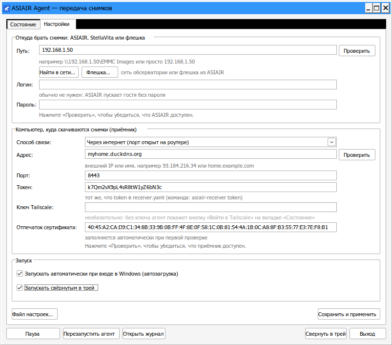

2. **Откуда брать снимки.** Проще всего нажать **«Найти в сети…»** под полем «Путь»: агент просканирует локальную сеть обсерватории и сам заполнит поля.
   * **ASIAIR** узнаётся по гостевой шаре `EMMC Images`: путь станет `\\IP\EMMC Images`, логин и пароль останутся пустыми.
   * **StellaVita** узнаётся по входу `as` / `astrostation`: путь станет `\\IP\Astrostation`, логин и пароль подставятся сами.
   * Если найдено несколько устройств, агент спросит, какое использовать.

   Вручную: в поле **«Путь»** введите IP ASIAIR (виден в приложении ASIAIR в настройках Wi-Fi/LAN), например `192.168.1.50`. Затем нажмите **«Проверить»**: должно появиться «OK: вход: гость (guest), шары: EMMC Images, …» — в списке будут все хранилища ASIAIR, в том числе SD-карта и флешка.

   **Если ASIAIR сменил адрес** (роутер обсерватории выдал ему другой IP), агент найдёт его сам: он ищет в сети устройство того же типа, на котором есть уже переданные им снимки, и исправляет адрес в настройках.

   **Флешка вместо сети.** Флешку из ASIAIR можно вставить в компьютер с агентом и нажать **«Флешка…»**: агент прочитает её (путь `usb:`), уже полученные по сети файлы обычно не скачиваются заново.
3. **Приёмник:**
   * **Способ связи** — «Через интернет» или «Через Tailscale» (см. шаг 2);
   * **Адрес** — внешний IP или имя домашнего компьютера, а для Tailscale — `asiair-receiver`;
   * **Порт** — 8443;
   * **Токен** — скопируйте со страницы приёмника.

   Нажмите **«Проверить»**. При первой проверке появится окно с отпечатком сертификата: сверьте его с отпечатком на странице приёмника и нажмите «Да». Должно появиться «OK: Приёмник доступен, токен и сертификат подходят». Если нет, окно скажет, на каком шаге остановилось: не найдено имя, порт не отвечает (проброс, брандмауэр, «серый» IP) или порт закрыт (приёмник там не слушает).
4. Отметьте **«Запускать автоматически при входе в Windows»** и, если хотите, **«Запускать свёрнутым в трей»**.
5. Нажмите **«Сохранить и применить»**.

Если ПК в обсерватории после перезагрузки остаётся без входа в систему, поставьте агента службой из командной строки **от имени администратора**: `asiair-agent.exe install`, затем `asiair-agent.exe start`. Окна у службы нет, управлять ею можно со страницы приёмника.

### Проверка, что всё работает

1. **Окно агента, вкладка «Состояние»:** «ASIAIR — подключено», «Приёмник — на связи».

   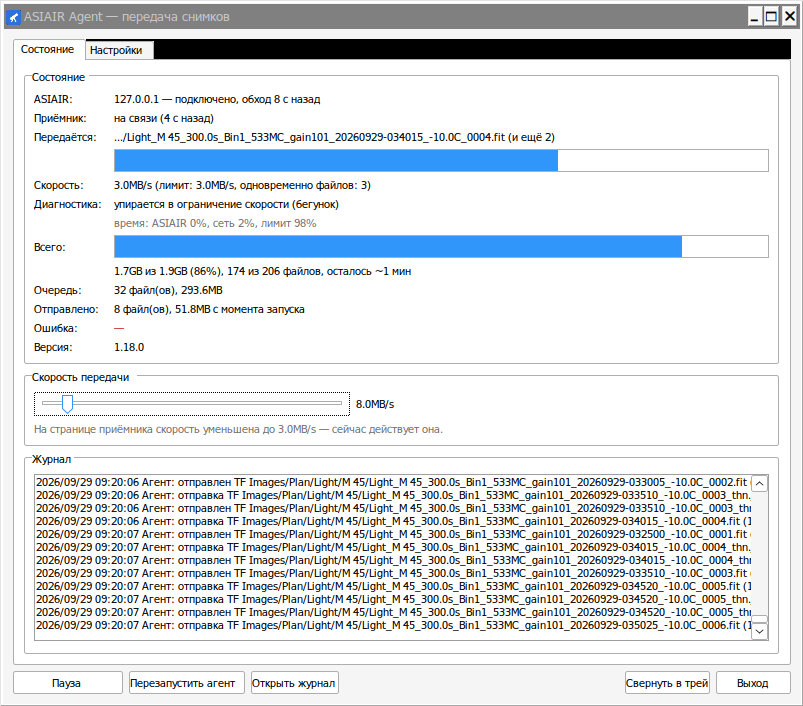

2. **Страница приёмника:** значок «агент на связи», в «Файлах» появился список с ASIAIR. Новый приёмник сначала **только показывает** структуру ASIAIR: в заголовке «передача не запущена», у файлов — «ждёт старта».
3. **Старт:** нажмите «Старт» в блоке «Передача» — агент начнёт передавать снимки. Если нужны не все, вместо «Старт» скачайте отдельные файлы или папки (см. ниже).
4. **Пробный кадр:** сделайте на ASIAIR короткий тестовый снимок. Через 1–2 минуты он появится в папке для снимков.
5. **Пробное удаление:** отметьте тестовый кадр на странице приёмника и нажмите «Удалить на ASIAIR». В «Командах удаления» статус станет «удалено».

Журналы: `asiair-agent.log` и `asiair-receiver.log` рядом с программами (в окне агента и в меню значка приёмника — «Открыть журнал»). Каждый день журнал начинается заново; дни старше 3 дней сжимаются в `.gz`, старше 7 — удаляются.

## Повседневная работа

### Окно агента

* «Свернуть» и крестик убирают окно в трей, передача продолжается. Окно открывается щелчком по значку или повторным запуском `.exe`.
* **Цвет значка:** зелёный — всё на связи; синий — идёт передача; жёлтый — пауза; красный — нет связи с ASIAIR или приёмником; серый — не заполнены настройки.
* **Пауза / Продолжить:** текущий файл прерывается и потом докачивается с того же места. На паузе агент по-прежнему обходит ASIAIR, отправляет список файлов и выполняет удаление со страницы приёмника. Пауза в окне агента и пауза на приёмнике независимы: передача идёт, когда обе сняты.

  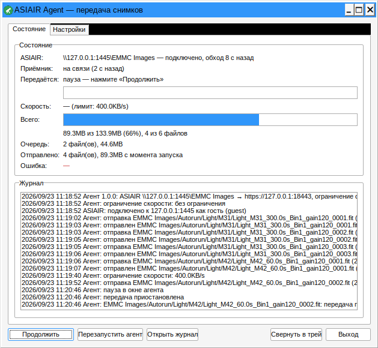
* **Бегунок «Скорость передачи»** на вкладке «Состояние» — потолок скорости: страница приёмника может её только уменьшить.
* **Меню значка:** «Открыть окно», «Настройки», «Пауза», «Перезапустить агент», «Выход».

  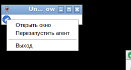

### Страница приёмника

Страница открывается щелчком по значку приёмника в трее или по адресу http://127.0.0.1:8080. Сверху — **общая информация** (агент, скорость, передача), ниже — сводка по ночам, настройки и файлы. Любую панель можно свернуть щелчком по заголовку, а «Общую информацию» и «Настройки» — целиком; выбор запоминается.

#### Агент и место на ASIAIR

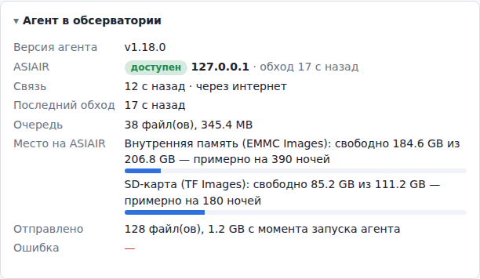

* **ASIAIR:** «доступен» или «недоступен» с текстом ошибки; пока агент ищет ASIAIR по сети, это тоже видно. В шапке страницы при этом появляется «ASIAIR недоступен».
* **Очередь** — сколько файлов и какого объёма ещё ждут отправки.
* **Журналы:** кнопка «Получить с агента» — агент присылает свои журналы за последние 3 дня и журнал обновлений (`asiair-agent-update.log`); файл настроек с токеном не отправляется. Ссылка «журналы от …» скачивает их вместе с журналами приёмника за те же дни одним архивом — его удобно приложить к сообщению об ошибке. Приёмник хранит 5 последних архивов в `receiver-data\agent-logs`. Работает и с телефона.
* **Место на ASIAIR:** свободное место внутренней памяти, SD-карты и флешки и на сколько ночей его хватит — по объёму последних ночей съёмки. Красным, если места меньше, чем на ночь.

#### Передача

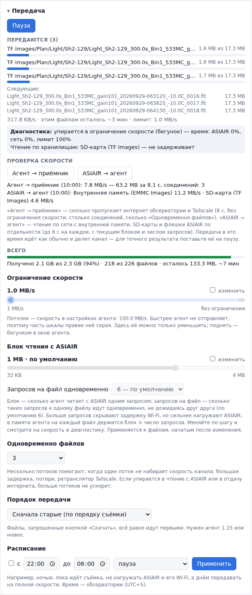

* **Старт / Пауза / Продолжить.** Пауза доходит до агента за секунду, текущий файл потом докачивается с того же места и сохраняется после перезапуска.

  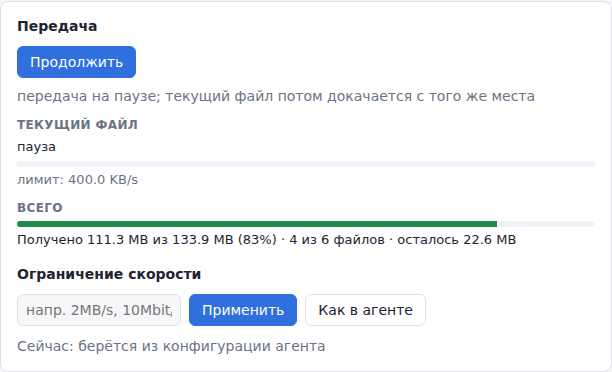

* **Передаются** — каждый файл, который идёт сейчас, со своей полосой; ниже — три файла, которые агент возьмёт следующими, общая скорость и лимит.
* **Диагностика** — во что упирается передача, с долями времени: «время: ASIAIR 10%, сеть 85%, лимит 5%». Строка «Чтение по хранилищам» показывает скорость чтения отдельно для внутренней памяти, SD-карты и флешки ASIAIR («SD-карта — ~176 KB/s на поток · Внутренняя память — не задерживает»), чтобы отличить медленную карту от медленной сети. В режиме Tailscale — идёт ли связь напрямую или через ретранслятор.
* **Проверка скорости** — две кнопки, результаты остаются на странице:
  * **«Агент → приёмник»** — агент 8 секунд шлёт приёмнику пустые данные без ограничения скорости, по стольким соединениям, сколько «Одновременно файлов». Показывает, сколько пропускают интернет обсерватории и Tailscale;
  * **«ASIAIR → агент»** — агент до 6 секунд читает самый большой файл каждого хранилища ASIAIR (внутренняя память, SD-карта, флешка) с текущими «блоком» и «запросами на файл». Показывает скорость каждого хранилища по сети.

  Обычная передача в это время не останавливается и делит канал, поэтому для точного результата сначала нажмите «Пауза». Нужны приёмник и агент новее 1.18.0.
* **Всего** — полоса по всем снимкам на ASIAIR и оценка оставшегося времени; коротко то же видно в шапке («передано 35%»).
* **Ограничение скорости:** бегунок от 1 до 100 MB/s, крайнее правое положение — без ограничения. Часть шкалы правее скорости, заданной в агенте, серая: быстрее агент не отправляет. Чтобы случайное касание на телефоне ничего не меняло, бегунок заблокирован: сначала поставьте галочку **«изменить»**; после изменения или через минуту он блокируется снова.
* **Чтение с ASIAIR** — два параметра, которые меняются только с галочкой «изменить» и действуют на файлы, начатые после изменения (число запросов умеет менять агент новее 1.18.0; 1.18.0 — только блок):
  * **Блок чтения** (бегунок, 32 KB – 4 MB, по умолчанию 1 MB) — сколько агент читает с ASIAIR одним запросом;
  * **Запросов на файл одновременно** (1–16, по умолчанию 6) — сколько таких запросов к одному файлу идут сразу, не дожидаясь ответа на предыдущий.
* **Одновременно файлов** (1–8, по умолчанию 3) — сколько файлов агент передаёт параллельно, каждый по своему соединению с приёмником.

##### Как подобрать скорость

Передача устроена в два уровня, и у каждого своя регулировка:

```
ASIAIR ──SMB (Wi-Fi)──► агент ──HTTPS (интернет)──► приёмник
        блок × запросов на файл        одновременно файлов
```

* **Чтение с ASIAIR.** По Wi-Fi каждый запрос ждёт ответа 20–60 мс. Если бы агент читал по одному запросу, скорость была бы «блок / задержка»: 1 MB за 50 мс — не больше 20 MB/s, а 32 KB — всего 0,6 MB/s. Поэтому к файлу идут сразу несколько запросов: пока ASIAIR отвечает на один, остальные уже в пути. Сколько данных «в полёте» на файл — блок × число запросов (по умолчанию 1 MB × 6 = 6 MB), а всего — ещё умножить на «Одновременно файлов».
* **Отправка домой.** Каждый файл идёт своим HTTPS-соединением; несколько файлов сразу помогают, когда одно соединение не набирает скорость канала — при большой задержке, потерях, ретрансляторе Tailscale.

Начните с **«Проверки скорости»**: две кнопки сразу покажут, какой участок медленнее. Если «ASIAIR → агент» у SD-карты заметно ниже, чем у внутренней памяти, упирается карта (или ASIAIR пишет на неё кадры); если медленно у всех хранилищ — сеть до ASIAIR; если медленно «агент → приёмник» — интернет обсерватории.

Затем подбирайте по «Диагностике» (блок «Передача») и графику скорости:

1. **«Упирается в ограничение скорости»** — всё в порядке, передача идёт так быстро, как разрешено бегунком.
2. **«Упирается в чтение с ASIAIR»:**
   * сначала попробуйте **больше запросов на файл** (8, 10, 12) — это главный способ скрыть задержку Wi-Fi;
   * затем **блок**: на слабом Wi-Fi с потерями иногда быстрее меньший блок (256–512 KB), на хорошем — 1–2 MB. Библиотека SMB всё равно дробит запросы крупнее 1 MB, поэтому 2–4 MB обычно не дают прироста;
   * если скорость не растёт — предел самого Wi-Fi ASIAIR: подключите ASIAIR кабелем или поставьте ближе к роутеру, переключите на 5 ГГц. Слишком много запросов нагружает ASIAIR — во время съёмки лучше не больше 6–8;
3. **«Упирается в сеть до приёмника»** — увеличьте **«Одновременно файлов»** (4–6). Если не помогает, это предел отдачи интернета в обсерватории.

Меняйте по одному параметру за раз и ждите пару минут: новые значения действуют на файлы, начатые после изменения. Память агента: на каждый передаваемый файл нужно «блок × запросов» (например, 4 MB × 16 = 64 MB), на всё — ещё × «Одновременно файлов».
* **Порядок передачи:** сначала старые, сначала новые (последняя ночь приходит первой) или сначала Light, потом калибровочные.
* **Расписание:** окно «с 22:00 до 06:00» по времени обсерватории, в котором передача на паузе или не быстрее выбранной скорости, — например, чтобы ночью не нагружать Wi-Fi ASIAIR во время съёмки.

#### Скорость передачи

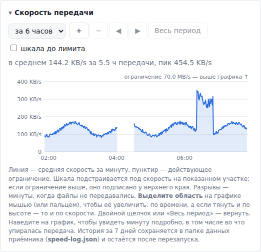

Средняя скорость по минутам за 1, 6, 24 часа, 3 или 7 дней; пунктир — действующее ограничение, разрывы — минуты без передачи. При наведении видна минута подробно: скорость, пик, лимит, число потоков и во что упиралась передача. История хранится 7 дней и остаётся после перезапуска.

* **Автомасштаб:** шкала подстраивается под скорость на показанном участке, поэтому и 128 KB/s при лимите 70 MB/s видны как кривая, а не как линия у нуля. Если ограничение выше графика, оно подписано у верхнего края. Галочка **«шкала до лимита»** возвращает шкалу, в которую помещается и ограничение.
* **Увеличение:** выделите область мышью (или пальцем) — увеличится этот отрезок времени; если тянуть и по высоте, то и диапазон скорости. Кнопки **+** и **−** увеличивают и уменьшают, **◀** и **▶** сдвигают по времени, **«Весь период»** (или двойной щелчок) возвращает всё. Под графиком написано, какой участок показан, а средняя скорость и пик считаются по нему.

#### Сводка по ночам

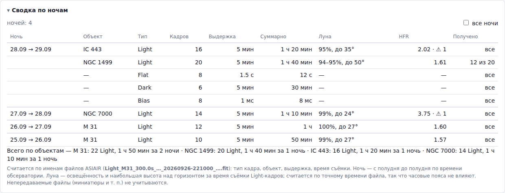

Для каждой ночи (с полудня до полудня по времени обсерватории): объект, тип кадров, сколько кадров, выдержка, суммарное время, Луна (освещённость и наибольшая высота во время съёмки), медианный HFR и сколько уже получено. Щелчок по строке показывает эти кадры в списке файлов. Внизу — итог по объектам: «M 31: 22 Light, 1 ч 50 мин за 2 ночи». Всё берётся из имён файлов ASIAIR (`Light_M 31_300.0s_…_20260926-221000_….fit`).

Для высоты Луны нужны координаты обсерватории (блок «Координаты обсерватории» в настройках). ASIAIR обычно записывает их в FITS-файлы, и приёмник берёт их оттуда сам.

#### Файлы

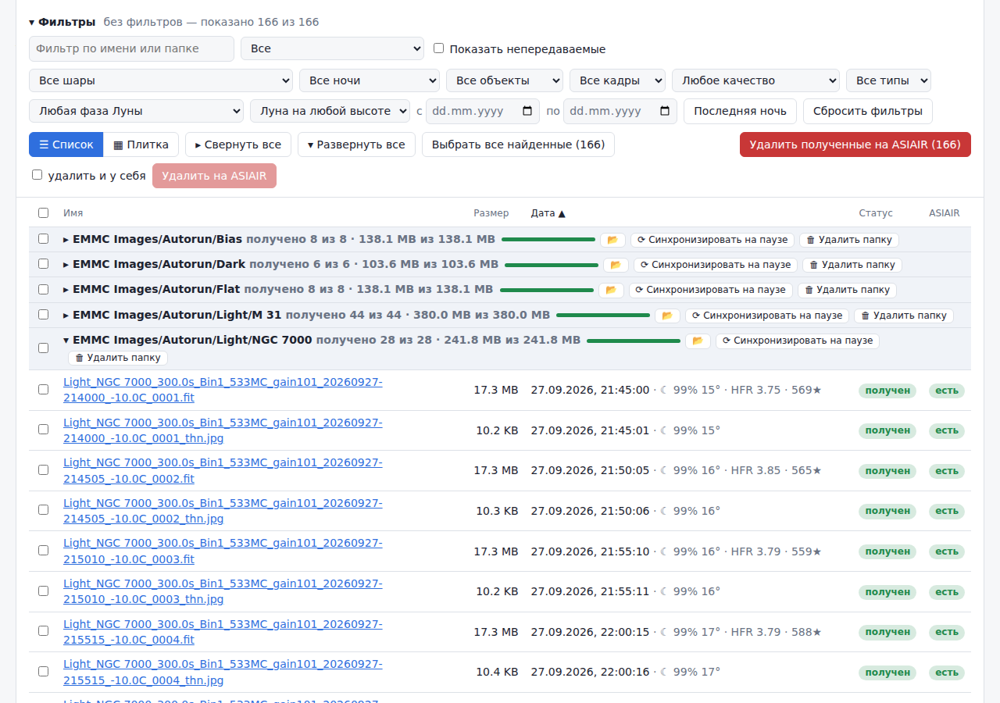

Вся структура ASIAIR по папкам. Уже полученные файлы — обычным цветом, ещё не полученные — серым. У заголовка папки — «получено 3 из 10», полоса прогресса и **время накопления** по типам кадров: «16 Light · 1 ч 20 мин». Под списком — накопление всех показанных кадров с учётом фильтров и сколько из него уже получено: например, выберите объект и «Хорошие» кадры, чтобы узнать, сколько годного материала набрано.

| Статус | Что значит |
|---|---|
| получен | файл у вас, совпадает с ASIAIR |
| передаётся 45% | передаётся сейчас |
| прервано на 60%, докачка в 21:14 | связь оборвалась; продолжится с этого места |
| ошибка, повтор в 21:14 | попытка не удалась, агент повторит сам (причина — в подсказке) |
| в очереди / ждёт старта | ждёт своей очереди или кнопки «Старт» |
| записывается на ASIAIR | файл ещё меняется; уйдёт, когда запись закончится |
| изменён на ASIAIR | на ASIAIR другая версия, она будет передана заново |
| только у меня | на ASIAIR файла уже нет |
| удаляется | ждёт выполнения команды удаления |
| не передаётся (фильтр) | миниатюры, журналы и т. п. |

* **Сортировка** — щелчком по заголовку столбца, внутри каждой папки; по умолчанию по дате.
* **Фильтры** (запоминаются): по имени, состоянию, хранилищу (внутренняя память, SD-карта, флешка), типу кадра (Light, Dark, Flat, Bias), типу файла, датам, ночи, объекту, качеству, Луне (освещённость и высота). Панель фильтров и кнопок остаётся сверху при прокрутке и сворачивается в одну строку-сводку.
* **Скачать отдельные файлы или папку:** пока передача на паузе или не запущена, у файлов есть кнопка «⤓ Скачать», у папок — «⤓ Скачать папку», для отмеченных — «Скачать выбранные». Когда передача идёт, «Скачать выбранные первыми» передаёт отмеченное раньше остального.

  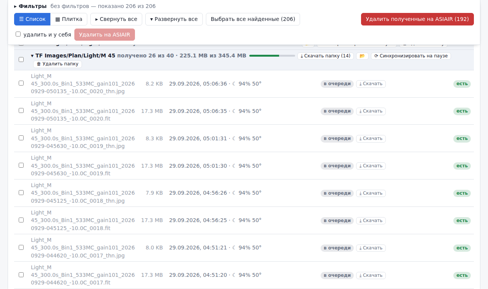

* **Синхронизировать на паузе:** выбранная папка (или папка выше, например `Autorun/Light` — все цели) передаётся, даже когда передача на паузе, включая новые кадры в ней.
* **Открыть папку** (📂, только на компьютере с приёмником) — в Проводнике, чтобы сразу перетащить кадры в PixInsight или Siril.

**Оценка кадров.** Приёмник в фоне находит звёзды на каждом полученном Light-кадре FITS и измеряет HFR (радиус, в котором половина света звезды; меньше — резче). Кадр сравнивается с остальными кадрами той же ночи и объекта: если звёзд на 40% меньше обычного (облака, дымка, роса) или HFR больше обычного на 30% (фокус, ветер, гидирование), он помечается ⚠ с объяснением. Фильтр «Подозрительные» собирает такие кадры.

**Плитка.** Кнопка «▦ Плитка» показывает полученные кадры миниатюрами с авторастяжкой, датой, Луной и оценкой; учитываются все фильтры.

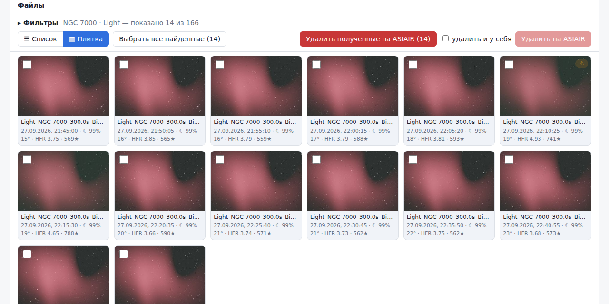

#### Удаление на ASIAIR

* Отметьте файлы галочками и нажмите **«Удалить на ASIAIR»**, или кнопкой **«🗑 Удалить папку»** удалите папку целиком (эту или любую выше) со всеми файлами и подпапками.
* **«Удалить полученные на ASIAIR (N)»** освобождает место: удаляет только файлы, которые уже получены и сверены по контрольной сумме, с учётом фильтров.
* Перед удалением окно показывает, сколько файлов и какой объём будет удалён, и предупреждает, если среди них есть ещё не полученные.
* Галочка **«удалить и у себя»** удаляет и копии на этом компьютере. Она действует на одно удаление и снимается сама, чтобы следующее удаление случайно не стёрло ваши копии.
* Команда доходит до агента за секунду, результат виден в «Командах удаления». Если агент не на связи, команда выполнится, когда он подключится.
* **Автоочистка ASIAIR** (в настройках): раз в 10 минут на ASIAIR удаляются файлы старше заданного срока, которые уже получены сюда и проверены. Непереданные и недокачанные файлы не трогаются.

#### Настройки

Блок «Настройки» сворачивается в одну строку-сводку. В нём:

* **Папка для снимков** и **Место на диске:** свободное место и запас «Оставлять свободным» (`5%` по умолчанию, можно `10GB`, `500MB` или `0`). Когда места меньше запаса, приёмник перестаёт принимать файлы, а агент встаёт на паузу; когда место освободится, передача продолжится сама. Там же — сколько места занимает каждый объект.
* **Автоочистка ASIAIR**, **Координаты обсерватории**, **Запуск на этом компьютере**, **Обновления**, **Подключение агента** (токен, отпечаток, интернет, Tailscale, брандмауэр), **Доступ с телефона**.
* Сохранённые пароли и ключи на страницу не передаются: если значение задано, в поле видны точки ●●●●●●●●. Чтобы заменить, введите новое.

### Просмотр снимков

Щелчок по имени полученного файла или по миниатюре открывает окно просмотра:

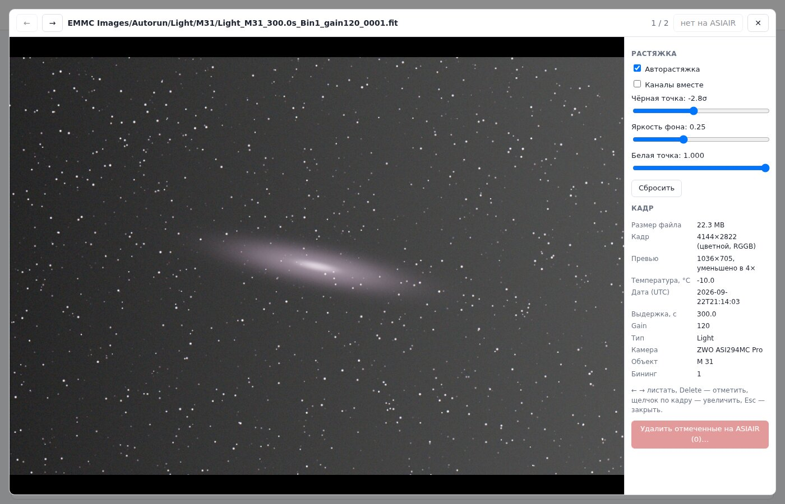

* **Авторастяжка** работает как STF в PixInsight: чёрная точка — по медиане и разбросу фона, полутона выводят фон на заданную яркость. Без растяжки сырой кадр почти чёрный:

  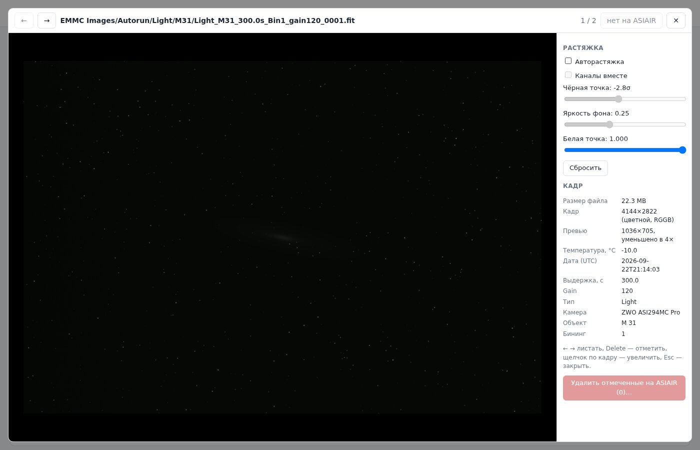

* **Цветные кадры** (`BAYERPAT` в заголовке) дебайеризуются. «Каналы вместе» выключено — каналы растягиваются раздельно, это убирает зелёный перекос цветной камеры.
* **Ползунки** «Чёрная точка», «Яркость фона» и «Белая точка» пересчитывают картинку сразу.
* **Щелчок по кадру** увеличивает его до полного разрешения, место щелчка оказывается по центру:

  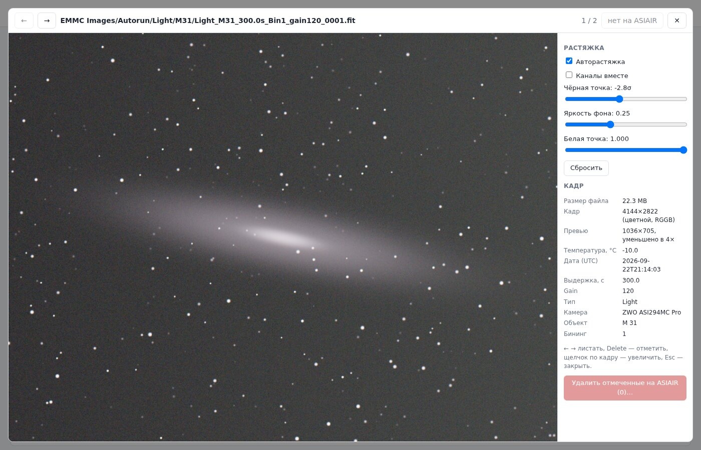

* **Масштаб** — кнопки − + ⤢ под картинкой (или клавиши **+**, **−**, **0**): ближе, дальше, вписать в окно; рядом — масштаб в процентах (100% — пиксель кадра в пиксель экрана). Увеличенный кадр двигается прокруткой или пальцем.
* **Блинк:** ▶ (или **пробел**) показывает кадры папки друг за другом по кругу, бегунок рядом задаёт скорость — от 0,5 до 10 кадров в секунду. Масштаб и место на кадре при этом не сбрасываются (и при листании ← → тоже): можно увеличить звезду или спутниковый трек и смотреть, как он меняется от кадра к кадру. Следующий кадр загружается, пока показан текущий, уже показанные кадры держатся в памяти браузера. На телефоне масштаб и блинк — отдельной строкой над кнопками ← →.

* **Отбраковка ночи:** кнопки **под картинкой** — «Отметить для удаления» слева, ← → справа (на телефоне они внизу экрана, под большой палец). ← → (или стрелки на клавиатуре, на телефоне — смахивание) листают кадры текущей папки; с галочкой «все папки» — дальше, в следующую папку. «Отметить для удаления» (или **Delete**) отмечает кадр для удаления на ASIAIR, «Удалить отмеченные на ASIAIR» удаляет все отмеченные разом.
* **Сбоку** — данные из заголовка FITS: объект, выдержка, gain, температура, камера, дата; и оценка кадра. JPG и PNG открываются в том же окне.

### С телефона

Страницу приёмника можно открыть на телефоне: видно, как идёт передача, можно поставить на паузу, скачать или синхронизировать папку, посмотреть кадры и удалить лишнее на ASIAIR. Вёрстка своя: крупные кнопки, фильтры свёрнуты, таблица прокручивается вбок.

<p align="center">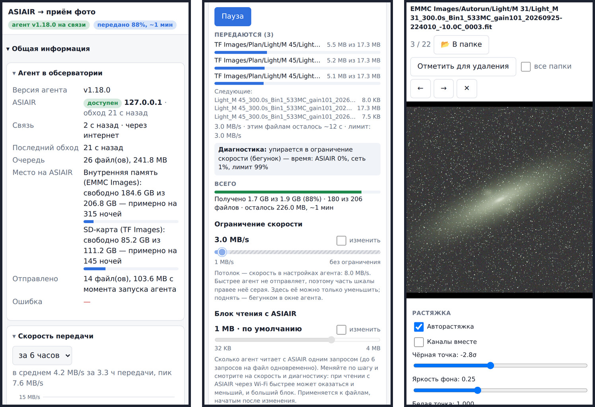</p>

Настройка — на домашнем компьютере, в блоке **«Доступ с телефона»**:

1. **Задайте пароль** (не меньше 8 символов). В `receiver.yaml` хранится только его хеш.
2. **Включите один или оба способа:**
   * **Через интернет:** страница открывается на том же порту, что и для агента: `https://<внешний адрес>:8443/`. Сертификат у приёмника самоподписанный, поэтому телефон при первом входе предупредит о нём — это нормально, подтвердите один раз.
   * **Через Tailscale:** поставьте на телефон приложение Tailscale и войдите в **ту же** учётную запись. Адрес показан в блоке: `https://asiair-receiver.<ваша-сеть>.ts.net/`. Если в панели Tailscale (**DNS**) включены **MagicDNS** и **HTTPS Certificates**, страницу можно установить на главный экран как приложение. Из интернета она не видна вовсе.
3. **По желанию — одноразовые коды:** «Включить…» показывает QR-код для приложения-аутентификатора (Google Authenticator, Aegis, 2FAS, 1Password и т. п.). После этого при входе нужны и пароль, и код.
4. Вход на телефоне запоминается на 90 дней. «Выйти на всех телефонах» — на домашнем компьютере.

**Безопасность.** С телефона не меняются настройки домашнего компьютера (папка, запуск, токен агента, сеть, Tailscale, пароли) — эти блоки на телефоне не показываются. После 5 неверных попыток вход с этого адреса закрыт на 15 минут.

### Значок приёмника в трее

* Щелчок открывает страницу. При наведении — подсказка: на связи ли агент, скорость, сколько в очереди, сколько места на диске.
* Меню: «Открыть страницу», «Пауза передачи» / «Продолжить передачу», «Открыть папку со снимками», «Открыть журнал», «Перезапустить приёмник», «Выход».

### Раскладка кадров для Siril

**`asiair-sorter.exe`** — отдельная программа с окном для подготовки к обработке. Она раскладывает кадры по папкам так, как их ждут стандартные скрипты Siril, и собирает **библиотеку калибровочных кадров**: дарки и биасы — по гейну, выдержке и температуре, флеты — по ночи, фильтру, гейну и выдержке. К каждой сессии лайтов она сама подбирает подходящие дарки, флеты и биасы.

Кадры можно брать:

* **из папки** — папка приёмника со снимками, флешка или копия памяти ASIAIR. Обходятся все вложенные папки, поэтому неважно, сняты кадры по плану (`Plan`) или через `Autorun`;
* **с приёмника по сети** — на другом компьютере (ноутбук, компьютер для обработки). Программа сама скачает только те кадры, которых там ещё нет, и продолжит прерванное скачивание. См. [Кадры с приёмника по сети](#кадры-с-приёмника-по-сети).

Программа не устанавливается и не обновляется сама: скачайте `asiair-sorter.exe` со страницы [Releases](https://github.com/arbalet1985/asiair_transmit_photo/releases/latest) и запускайте из любой папки. Новую версию скачивайте так же. Её настройки хранятся в `%APPDATA%\asiair-sorter\`.

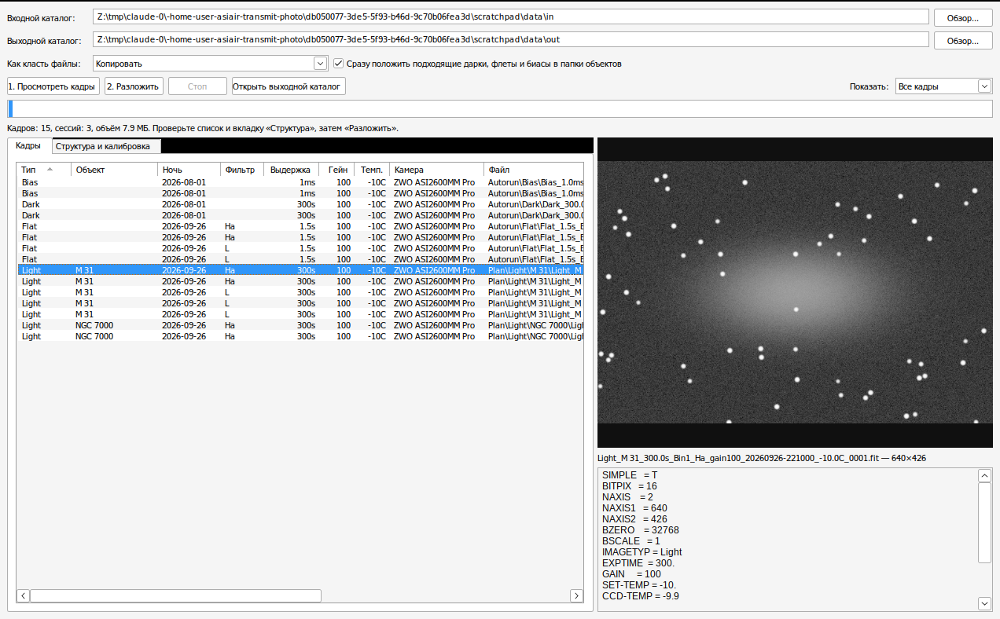

* **Фильтр** над таблицей оставляет кадры, где есть все введённые слова в любых столбцах: `m31 ha 300s`, `2026-09-30 flat`, часть имени папки. Вместе с ним работает «Показать:» по типу кадра. Под таблицей — сколько кадров показано и их суммарная выдержка.
* **«В папке»** — сколько кадров в папке этого файла и их суммарная выдержка.
* **Предпросмотр** увеличивается кнопками − + «Вписать» «100%» или колесом мыши, увеличенный кадр перетаскивается мышью; для увеличения кадр читается в полном разрешении. Масштаб и место сохраняются при выборе другого кадра.
* **Блинк:** «▶ Блинк» показывает кадры таблицы друг за другом по кругу — те, что остались после фильтра и «Показать:», в порядке сортировки. Бегунок рядом задаёт скорость, от 0,5 до 10 кадров в секунду. Масштаб и место на кадре не сбрасываются; следующий кадр читается заранее, прочитанные держатся в памяти, так что следующие круги идут быстрее.

#### Что получается

```
<выходной каталог>
├─ Objects\                                   лайты: объект → ночь_фильтр_выдержка_гейн_камера
│  └─ M 31\
│     ├─ 2026-09-26_Ha_300s_gain100_ASI2600MM Pro\   одна сессия = одна папка для Siril
│     │  ├─ lights\       кадры
│     │  ├─ darks\        ─┐ подходящие кадры из Library
│     │  ├─ flats\         │ (сразу — с галочкой «Сразу положить…»,
│     │  ├─ biases\       ─┘  иначе список папок в калибровка.txt)
│     │  ├─ process\      сюда Siril пишет результаты
│     │  └─ калибровка.txt
│     └─ 2026-09-27_Ha_300s_gain100_ASI2600MM Pro\   следующая ночь того же объекта
└─ Library\
   ├─ Darks\ZWO ASI2600MM Pro\gain100_300s_-10C     камера, гейн, выдержка, температура
   ├─ DarkFlats\ZWO ASI2600MM Pro\gain100_1.5s      камера, гейн, выдержка
   ├─ Biases\ZWO ASI2600MM Pro\gain100              камера, гейн
   └─ Flats\ZWO ASI2600MM Pro\2026-09-26_Ha_gain100_1.5s   камера, ночь, фильтр, гейн, выдержка
```

* **Сессия** — лайты одного объекта за одну ночь с одним фильтром, выдержкой, гейном и одной камерой. Если за ночь снимали несколько фильтров (или двумя камерами), у объекта будет несколько папок с этой датой. Камера в конце имени — без «ZWO » (`ASI2600MM Pro`); если в заголовке её нет, имя заканчивается гейном.
* **Ночь** считается с полудня до полудня по времени из имени файла ASIAIR. Поэтому флеты, снятые утром после съёмки, попадают в ту же ночь, что и лайты.
* **Дарки и биасы** не делятся по датам: их снимают раз в несколько месяцев, и они копятся в одной папке. Температура — заданная температура охлаждения (или измеренная, округлённая до градуса). Имя камеры (`INSTRUME`) отделяет библиотеки разных камер — дарков, биасов, дарк-флетов и флетов; бининг дописывается, если он не 1 (`_bin2`).
* Файлы сохраняют имена ASIAIR. Уже разложенный файл (то же имя и размер) повторно не копируется. Одинаковые кадры из разных мест (например, с памяти ASIAIR и с флешки) кладутся один раз.
* В `калибровка.txt` каждой сессии записано, из каких папок `Library` брать калибровку и чего не хватает.
* Если всё разложено прежней версией (флеты в `Library\Flats\2026-09-26_…`, сессии `…_gain100` — без имени камеры), при следующей раскладке это **переносится** под новые имена, а не копируется и не скачивается заново. Папка сессии переезжает целиком — с `darks`, `flats`, `biases`, результатами Siril в `process` и `калибровка.txt`. Если в одной старой сессии оказались кадры двух камер, её лайты расходятся по двум новым сессиям, а остальное остаётся в старой папке. Опустевшие старые папки удаляются.

#### Как подбирается калибровка

| Папка сессии | Что туда подходит |
|---|---|
| `darks` | дарки той же камеры, гейна, выдержки и бининга; из них — с ближайшей температурой (если разница больше 2 °C, будет предупреждение) |
| `flats` | флеты того же фильтра: той же ночи, иначе ближайшей; при равном расстоянии — более поздней (флеты обычно снимают после лайтов) |
| `biases` | для калибровки флетов: дарк-флеты с гейном и выдержкой флетов, а если их нет — биасы с гейном флетов |

Библиотека в выходном каталоге, собранная раньше, тоже участвует в подборе. Дарки достаточно разложить один раз, а потом раскладывать только новые ночи.

#### Кадры из папки

1. В поле **«Откуда»** укажите папку с кадрами (кнопка «Обзор…»), в поле **«Выходной каталог»** — куда раскладывать. Выходной каталог может лежать и внутри входного: при обходе он пропускается.
2. Выберите, **как класть файлы**:
   * **Копировать** — оригиналы остаются на месте;
   * **Перемещать** — оригиналы переносятся;
   * **Жёсткие ссылки** — файл не копируется, а получает второе имя: место на диске не тратится. Работает только на том же диске и в NTFS; если нельзя, файл просто копируется. Так удобно раскладывать папку приёмника, не удваивая её размер.
3. По желанию поставьте галочку **«Сразу положить подходящие дарки, флеты и биасы в папки объектов»**. Без неё папки `darks`, `flats`, `biases` остаются пустыми, а список подходящих папок есть в `калибровка.txt`.
4. Нажмите **«1. Просмотреть кадры»**. Программа читает заголовки FITS: тип кадра, объект, фильтр, выдержку, гейн, температуру, камеру, бининг. Если в заголовке чего-то нет, она берёт это из имени файла ASIAIR и папок. Файлы при этом не меняются.
5. Проверьте результат:
   * вкладка **«Кадры»** — что куда попадёт. Столбцы сортируются щелчком, «Показать» оставляет один тип кадров. Щелчок по кадру показывает его с авторастяжкой и заголовок FITS;
   * вкладка **«Сводка по ночам»** — как на странице приёмника: по каждой ночи объекты и типы кадров, фильтр, число кадров, выдержки, накопление и сколько из них уже лежит в выходном каталоге; внизу — итог по объектам («M 31: 22 Light, 1 ч 50 мин за 2 ночи»). Двойной щелчок по строке показывает её кадры на вкладке «Кадры», «Показать все» возвращает весь список;
   * вкладка **«Структура и калибровка»** — сессии по объектам с суммарной выдержкой, подобранная к ним калибровка и ⚠, чего не хватает.
6. Нажмите **«2. Разложить»** и подтвердите. **«Стоп»** прерывает работу; при следующем запуске уже разложенное пропускается.

#### Кадры с приёмника по сети

Так кадры раскладываются на другом компьютере: программа входит на приёмник так же, как телефон, и скачивает кадры по сети.

**На домашнем компьютере с приёмником** (один раз), в блоке **«Доступ с телефона»** на странице приёмника:

1. Задайте пароль.
2. Включите нужный способ:
   * **«Через интернет»** — страница открывается на порту агента, `https://<адрес>:8443/`. Этот же способ нужен и в домашней сети;
   * **«Через Tailscale»** — если второй компьютер тоже в вашей сети Tailscale.

**На втором компьютере:**

1. В поле **«Откуда»** впишите адрес приёмника вместо папки:
   * `https://192.168.1.10:8443/` — адрес компьютера с приёмником в домашней сети (его видно в настройках сети Windows или на роутере);
   * `https://<внешний адрес>:8443/` — через интернет, тот же адрес, что у агента;
   * `https://asiair-receiver.<ваша-сеть>.ts.net/` — через Tailscale (на этом компьютере должно работать приложение Tailscale с той же учётной записью). Адрес показан на странице приёмника в блоке «Доступ с телефона»;
   * `http://127.0.0.1:8080/` — на самом компьютере с приёмником (пароль не нужен). Впрочем, там проще указать папку со снимками.
2. Появятся поля **«Пароль приёмника»** и **«Код»**. Введите пароль доступа с телефона, а код — только если на приёмнике включены одноразовые коды.
3. Укажите выходной каталог и нажмите **«1. Просмотреть кадры»**. Вход запоминается на 90 дней (сам пароль не сохраняется), поэтому в следующие разы поля можно оставить пустыми.
4. В строке состояния видно, сколько кадров **нет в выходном каталоге** и сколько они весят. Нажмите **«2. Разложить»**: скачаются только они, остальные уже на месте.
5. Кнопка **«Удалённые на приёмнике»** подсвечивает красным и показывает только те кадры выходного каталога, которых на приёмнике больше нет (их удалили там, а здесь копия осталась). Кнопка **«Удалить с диска…»** рядом удаляет показанные из них (фильтр и строка сводки сужают список) — после подтверждения, в Корзину, если она есть на этом диске (на сетевой папке — навсегда); затем список просматривается заново. **«Снять подсветку»** возвращает обычный вид. Кнопка появляется, только когда в «Откуда» указан адрес приёмника, и работает после «Просмотреть кадры».

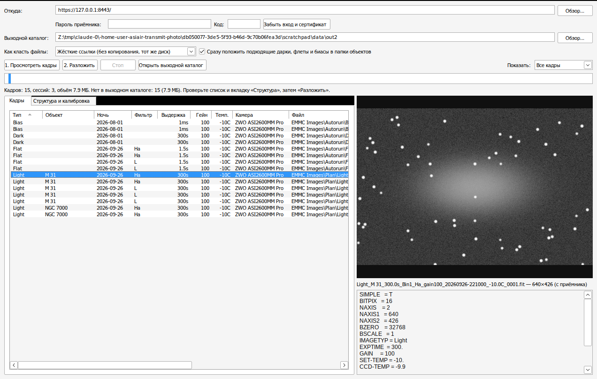

Как это работает:

* **Список и заголовки.** Программа берёт у приёмника список уже полученных кадров и читает у каждого только заголовок FITS — первые килобайты файла. Заголовки запоминаются, поэтому в следующий раз читаются только новые кадры. Кадры, ещё не дошедшие до приёмника, не показываются: они появятся при следующем запуске.
* **Докачка.** Прогресс показывается в байтах, со скоростью и оставшимся временем. Если скачивание прервалось («Стоп», обрыв связи, выключение компьютера), недокачанный файл остаётся рядом с расширением `.part`. Следующий запуск продолжит его с того же места.
* **Приёмник не меняется:** программа только читает, ничего не удаляет. «Перемещать» для приёмника работает как «Копировать». «Жёсткие ссылки» относятся к калибровке в папках объектов: она ставится ссылками на уже скачанную библиотеку, без лишнего места.
* **Предпросмотр** уменьшает сам приёмник, поэтому по сети идут сотни килобайт, а не весь кадр.
* **Безопасность.** Соединение шифруется. Сертификат приёмника запоминается при первом подключении, как у агента. Если сертификат потом сменится, программа откажется подключаться: это защищает от подмены. После переустановки приёмника сверьте отпечаток со страницей приёмника и нажмите **«Забыть вход и сертификат»** — при следующем подключении снова понадобится пароль.

#### Обработка в Siril

1. В Siril нажмите значок домика (**«Сменить рабочую папку»**) и выберите папку сессии, например `Objects\M 31\2026-09-26_Ha_300s_gain100_ASI2600MM Pro`.
2. Если галочка «Сразу положить…» не стояла, разложите калибровку по списку из `калибровка.txt`: скопируйте кадры из указанных папок `Library` в `darks`, `flats`, `biases` этой сессии.
3. Запустите скрипт из меню **Scripts**: `Mono_Preprocessing` для монохромной камеры или `OSC_Preprocessing` для цветной. Скрипты ищут кадры именно в `lights`, `darks`, `flats`, `biases` и пишут результат в `process`.
4. Каждую ночь (сессию) калибруйте отдельно: у неё свои флеты. Сложенные кадры нескольких ночей одного фильтра потом объединяют в одну стопку.

#### Порядок работы

* **Один раз:** разложите дарки и биасы (например, из папки приёмника или с флешки). Они лягут в `Library` и будут подбираться ко всем следующим сессиям.
* **После съёмки:** запустите программу с тем же выходным каталогом. С приёмника она докачает только новые ночи, разложит их и подберёт калибровку из библиотеки.

#### Если что-то не так

| Что видно | Что делать |
|---|---|
| «приёмник просит войти» | Введите пароль доступа с телефона (и код, если он включён) и нажмите «Просмотреть кадры» снова. Вход мог закончиться через 90 дней или после «Выйти на всех телефонах». |
| «страницы нет: включите на приёмнике «Доступ с телефона»…» | На странице приёмника не включён способ доступа («Через интернет» для адреса с `:8443`, «Через Tailscale» для адреса `.ts.net`) или неверный адрес. |
| Не подключается по адресу в домашней сети | Проверьте адрес и порт (`listen` в `receiver.yaml`, по умолчанию 8443). Брандмауэр Windows на компьютере с приёмником должен пропускать программу — см. «Брандмауэр Windows» на странице приёмника. |
| «сертификат приёмника сменился» | Приёмник переустановили или удалили `receiver-data`. Сверьте отпечаток на странице приёмника и нажмите «Забыть вход и сертификат». Если приёмник не трогали — не подключайтесь: возможно, отвечает чужой сервер. |
| «слишком много неверных попыток» | После 5 ошибок вход с этого адреса закрыт на 15 минут. |
| В сессии ⚠ «нет дарков» / «нет флетов» | Подходящих кадров нет ни во входе, ни в `Library`. Разложите их (для дарков — те же камера, гейн, выдержка), затем снова «Просмотреть кадры». |
| Тип кадра «?» | В заголовке нет `IMAGETYP`, а в имени и папках нет Light/Dark/Flat/Bias. Такие файлы остаются на месте. |
| «в … уже есть другой файл с таким именем» | В выходном каталоге лежит файл с тем же именем, но другого размера (например, повреждённый). Удалите его и разложите снова. |

#### Планировщик ночи

Вкладка **«Планировщик»** сортировщика составляет план съёмки на ночь для нескольких объектов и показывает анимацией, как телескоп будет переходить между ними.

**Небо обсерватории.** После «Просмотреть кадры» планировщик берёт из заголовков Light-кадров координаты обсерватории (`SITELAT`, `SITELONG`), объекта (`RA`, `DEC`) и время (`DATE-OBS`) и рисует полосу неба: азимут С–В–Ю–З–С, высота до зенита, точки — где снимались кадры (цвет — объект).
* **Горизонт** (жёлтая линия) угадывается по тому, на какой высоте начинались сессии восходящих объектов и кончались заходящих; линия никогда не проходит выше снятых кадров.
* **Закрытые зоны** (красная штриховка, например провода): если в серии одного объекта есть разрыв дольше трёх кадров и 10 минут, в который не снималось вообще ничего, и это не перекладка через меридиан, путь объекта за это время помечается закрытым. Если в разрыв снимался другой объект, зона только предлагается (бледная штриховка): возможно, переключились сами.
* **Правка мышкой:** тащите точки горизонта; щелчок — новая точка; правая кнопка — удалить точку или зону. Shift + протянуть — новая закрытая зона; зону можно сдвинуть, а за угол — изменить; щелчок по бледной зоне её принимает. «Горизонт по кадрам» заново угадывает всё по кадрам, «Сбросить» оставляет ровный горизонт на высоте «Не ниже». Исправленный вручную горизонт сохраняется и новыми кадрами не заменяется.

**Объекты.** Найдите объект по названию — `M 31`, `NGC 7000`, `IC 1805`, `Sh2-274`, `C 20`, «Андромеда», «Медуза», «Сердце» — во встроенном каталоге (OpenNGC: NGC, IC, Мессье, Колдуэлл; каталог Шарплесса Sh2), среди объектов снятых кадров или, если нигде нет, в SIMBAD через интернет. Для каждого задайте выдержку, сколько часов нужно (0 — сколько получится) и фильтр. **Порядок строк — приоритет:** в каждый момент снимается самый верхний объект, который виден (над горизонтом, вне закрытых зон, не ближе заданного расстояния к Луне) и которому ещё нужна выдержка. Галочка убирает объект из плана, не удаляя его.

Пример: М 31 закрывают провода — планировщик уходит на час на запасной объект, возвращается к М 31, как только она выходит из-за проводов, а когда над деревьями на востоке поднимается Медуза (стоит выше в списке), переходит на неё. На объект, который будет виден меньше «Не идти на объект меньше чем на» минут, планировщик не переходит; если снимаемый объект закрыт ненадолго (меньше, чем уйти и вернуться), он ждёт.

**Издержки** — поля над таблицами: переход на другой объект (наведение, решение поля, запуск гида; 5 минут), фокусировка (2 минуты каждые 60 минут, по желанию и после каждого перехода), дизеринг (секунды через каждые N кадров), время между кадрами, перекладка через меридиан (через сколько минут после меридиана и сколько длится). Ночь — пока Солнце ниже выбранных сумерек; время показывается по часам обсерватории (часовой пояс угадывается по кадрам).

**План и анимация.** «Составить план» выдаёт таблицу шагов: переходы, фокусировки, перекладки, съёмка (кадров, высота объекта в начале и конце, расстояние до Луны). Щелчок по шагу переносит анимацию на его начало; ▶ проигрывает ночь: перекрестие телескопа движется по пути объекта, переходит к следующему, толстой линией показано время съёмки; Луна — с фазой, бледные точки — её путь за ночь. «Копировать план» — текст для ввода в план ASIAIR (цель, время, выдержка × кадры), «Сохранить CSV…» — таблица для Excel. План и небо пересчитываются при любой правке.

Каталог объектов: [OpenNGC](https://github.com/mattiaverga/OpenNGC) (© Mattia Verga, лицензия CC-BY-SA 4.0) и каталог HII-областей Шарплесса (VizieR VII/20). Обновить встроенную выборку: `go generate ./internal/catalog`.

## Обновления

> **⚠ Обновление нужно контролировать.** Известны случаи, когда программа, запущенная через автозагрузку Windows (не службой), после автообновления не завершалась: оставалось два процесса агента, и передача не шла. Пока причина не найдена, после каждого обновления проверьте, что всё работает (см. [Как проверить обновление](#как-проверить-обновление)). Обновляйте агент, когда у вас есть удалённый доступ к ПК обсерватории (AnyDesk, RDP и т. п.) и не во время съёмки. Приёмнику можно выключить галочку «Устанавливать обновления автоматически» и обновлять его кнопкой «Обновить сейчас», когда вы у компьютера.

Программы обновляются сами:

1. Приёмник раз в 6 часов (и по кнопке «Проверить») смотрит последний релиз на GitHub, скачивает новую версию, проверяет контрольную сумму, заменяет свой `.exe` и перезапускается. Служба Windows запускается снова через 30 секунд, программа в трее — сразу.
2. Агенту новая версия приходит от приёмника по тому же защищённому каналу, что и снимки. В окне агента появляется кнопка **«Обновить до X»**: агент с окном без спроса не обновляется. Агент-служба обновляется сам (если в `agent.yaml` не стоит `auto_update: false`).
3. Передача после перезапуска продолжается с того же места.

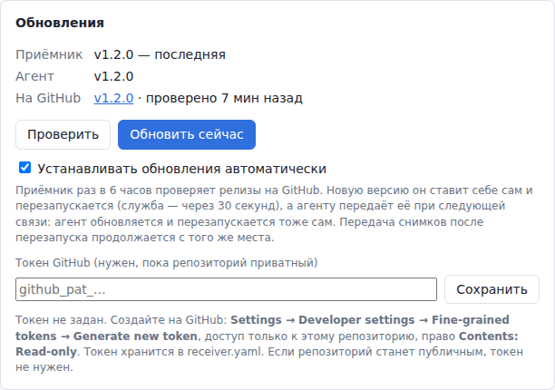

**Страховка агента.** Обсерватория далеко, поэтому неудачное обновление не оставит агент выключенным: старая версия остаётся рядом (`asiair-agent.old.exe`) и запускается «сторожем». Если новая версия за 3 минуты (служба — за 6) не запустилась и не связалась с приёмником, сторож возвращает старую версию, а неудачная больше не ставится. Журнал сторожа — `asiair-agent-update.log`.

### Как проверить обновление

1. **Страница приёмника:** в шапке — «приёмник vX» и «агент vX на связи» с новыми версиями; в блоке «Передача» файлы идут (если передача не на паузе).
2. **Диспетчер задач** (Ctrl+Shift+Esc → «Подробности») на каждом компьютере:
   * дома — один процесс `asiair-receiver.exe`;
   * в обсерватории — один процесс `asiair-agent.exe`. Процесс `asiair-agent.old.exe` в первые 3 минуты после обновления — это «сторож» (см. ниже), он завершается сам.
3. **Если процессов два, программа не отвечает или агент не выходит на связь:** в Диспетчере задач завершите все процессы `asiair-agent` (или `asiair-receiver`) и запустите программу снова ярлыком или двойным щелчком по `.exe` — либо перезагрузите компьютер. Передача продолжится с того же места: новая версия уже на месте.
4. **Сообщите о сбое** в [Issues](https://github.com/arbalet1985/asiair_transmit_photo/issues) и приложите журналы за этот день: на странице приёмника в блоке «Агент в обсерватории» нажмите «Журналы → Получить с агента» и скачайте архив (в нём журналы агента, сторожа обновлений и приёмника). Если агент не на связи, журналы лежат рядом с программами: `asiair-agent.log`, `asiair-agent-update.log`, `asiair-receiver.log`.

Автообновление выключается галочкой «Устанавливать обновления автоматически» на странице приёмника (тогда обновляет кнопка «Обновить сейчас»). Прав администратора обновление не требует; папка с программой должна быть доступна для записи. Программы, собранные вручную, имеют версию «dev» и сами не обновляются.

Если вы собираете свои релизы в **приватной** копии репозитория, укажите её в `update_repo` и вставьте токен GitHub с правом **Contents: Read-only** на странице приёмника (раскрывающийся пункт «Токен GitHub» в блоке «Обновления»). Для основного, публичного репозитория токен не нужен.

## Файлы настроек и команды

Обе программы хранят настройки в YAML-файле рядом с `.exe` и создают его сами. Основное настраивается мышкой; остальное можно поменять в файле (у агента — кнопка «Файл настроек…») и перезапустить программу. Примеры с комментариями — в папке [`configs/`](configs).

### `agent.yaml` (агент)

| Параметр | По умолчанию | Что это |
|---|---|---|
| `asiair` | — | Путь к ASIAIR: `192.168.1.50`, `\\192.168.1.50\EMMC Images`, `smb://логин:пароль@IP/шара`, `dir:Z:\` (подключённый диск или папка), `usb:` (флешка из ASIAIR в этом компьютере) |
| `shares` | `["*"]` | Какие шары обходить: `*` — все хранилища ASIAIR (внутренняя память, SD-карта, флешка). Только внутренняя память: `["EMMC Images"]` |
| `username`, `password` | пусто | Логин к ASIAIR, обычно не нужен |
| `receiver_url` | — | Адрес приёмника, `https://адрес:8443` |
| `token` | — | Токен приёмника |
| `receiver_fingerprint` | — | Отпечаток сертификата приёмника, заполняется кнопкой «Проверить» |
| `connection` | `internet` | Способ связи: `internet` или `tailscale` |
| `tailscale_hostname` | `asiair-agent` | Имя агента в Tailscale |
| `tailscale_authkey` | пусто | Ключ Tailscale вместо входа через браузер |
| `tailscale_control_url` | пусто | Свой сервер Headscale вместо Tailscale |
| `max_rate` | `100MB/s` | Потолок скорости; `0` — без ограничения. Страница приёмника может его только уменьшить |
| `extensions` | `.fit .fits .jpg .png .tif .xisf` | Какие файлы передавать |
| `exclude_extensions` | — | Какие расширения не передавать никогда |
| `exclude` | `Thumbnail` | Какие папки пропускать |
| `scan_interval` | `1m` | Как часто искать новые файлы |
| `poll_interval` | `15s` | Как часто агент сообщает приёмнику состояние (команды приходят сразу) |
| `min_file_age` | `30s` | Файл отправляется, только если не менялся столько времени |
| `state_file`, `log_file` | `agent-state.json`, `asiair-agent.log` | Список переданных файлов и журнал |
| `log_keep`, `log_compress_after` | `7d`, `3d` | Сколько хранить журналы прошлых дней и через сколько сжимать их в `.gz` |
| `auto_update` | `true` | Ставить новую версию без спроса — для службы и консоли. Агент с окном всегда ждёт кнопку «Обновить» |

### `receiver.yaml` (приёмник)

| Параметр | По умолчанию | Что это |
|---|---|---|
| `listen` | `:8443` | Порт для агента (и для телефона через интернет) |
| `internet` | `false` | Принимать агента через интернет на порту `listen`. Меняется на странице |
| `ui_listen` | `127.0.0.1:8080` | Адрес веб-страницы. Для доступа из домашней сети — `0.0.0.0:8080`, и тогда обязательно задайте `ui_user` и `ui_password` |
| `ui_user`, `ui_password` | пусто | Пароль на веб-страницу |
| `remote_internet`, `remote_tailscale` | `false` | Страница с телефона через интернет / через Tailscale. Меняются на странице |
| `remote_password`, `remote_totp` | пусто | Хеш пароля и секрет одноразовых кодов для входа с телефона. Задаются на странице |
| `token` | создаётся сам | Токен для агента |
| `dest_dir` | `photos` | Папка для снимков |
| `data_dir` | `receiver-data` | Сертификат и служебное состояние |
| `tls_cert`, `tls_key` | пусто | Свой сертификат вместо самоподписанного |
| `disable_tls` | `false` | Отключить HTTPS (только при связи через VPN) |
| `max_rate` | пусто | Начальное ограничение скорости для агента |
| `min_free` | `5%` | Сколько места оставлять свободным на диске со снимками |
| `log_file`, `log_keep`, `log_compress_after` | `asiair-receiver.log`, `7d`, `3d` | Журнал |
| `auto_update` | `true` | Проверять релизы на GitHub и обновляться. Меняется на странице |
| `update_repo` | `arbalet1985/asiair_transmit_photo` | Репозиторий с релизами |
| `update_token` | пусто | Токен GitHub — только если `update_repo` приватный |
| `tailscale` | `false` | Принимать агента через Tailscale. Меняется на странице |
| `tailscale_hostname`, `tailscale_authkey`, `tailscale_control_url` | `asiair-receiver`, пусто, пусто | Как у агента |

### Команды

| Команда | Действие |
|---|---|
| (без команды) | в Windows: окно агента / приёмник в трее |
| `run` | запуск в консоли (так же работают версии для Linux) |
| `install` / `uninstall` | установить / удалить службу (от имени администратора) |
| `start` / `stop` / `restart` / `status` | управление службой |
| `firewall-allow` | добавить разрешение в брандмауэр Windows (от имени администратора) |
| `-config путь.yaml` | другой файл настроек |
| `asiair-agent check` | проверить связь с ASIAIR и приёмником |
| `asiair-receiver token` | сгенерировать токен |
| `asiair-receiver fingerprint` | показать отпечаток сертификата |

## Частые проблемы

| Что видно | Что делать |
|---|---|
| Проверка ASIAIR: «не отвечает» | Неверный IP или ПК не в той же сети, что ASIAIR. Проверьте IP в приложении ASIAIR или нажмите «Найти в сети…». |
| Проверка ASIAIR: «неверный логин или пароль» | Очистите логин и пароль: ASIAIR пускает гостя. |
| Проверка приёмника: «не отвечает» | Не открыт порт 8443 на роутере или в брандмауэре, «серый» IP или приёмник не запущен. С телефона через мобильный интернет откройте `https://<внешний IP>:8443`: предупреждение о сертификате — нормально, а если страница не открывается, порт закрыт. |
| «приёмник отклонил токен» | Скопируйте токен со страницы приёмника заново. Если там нажимали «Новый…», токен сменился. |
| «отпечаток сертификата не совпадает» | Приёмник переустановили или удалили `receiver-data`. Нажмите в агенте «Проверить» у приёмника, сверьте новый отпечаток со страницей приёмника и нажмите «Да». Если не совпадает — «Нет»: возможно, отвечает чужой сервер. |
| «мало места на диске», агент на паузе | Освободите место на диске со снимками или уменьшите запас в блоке «Место на диске» — передача продолжится сама. |
| Tailscale: «нужно войти» | Нажмите «Войти в Tailscale…» на странице приёмника или в окне агента. |
| Tailscale подключён, но агент не находит приёмник | Агент и приёмник вошли в **разные** учётные записи Tailscale, или в адресе агента другое имя, чем на странице приёмника. |
| Tailscale: «устройство ждёт подтверждения» | В панели Tailscale включено подтверждение устройств: login.tailscale.com → Machines → Approve. |
| Windows: «Издатель не проверен» / «Windows защитила ваш компьютер» | См. [Установка](#установка). |
| Windows спрашивает «Разрешить доступ к сети?» | Разрешите. Чтобы не спрашивала: на странице приёмника «Брандмауэр Windows → Разрешить…», в агенте — «Да» при сохранении режима Tailscale. |
| Приёмник как служба, агент не подключается через интернет | Служба не может показать вопрос брандмауэра. Нажмите «Разрешить…» в строке «Брандмауэр Windows» на странице. |
| Агент «уже работает» | Запущена служба агента или другое окно: одновременно они не работают. |
| После обновления два процесса агента (или приёмника), ничего не работает | Завершите все процессы программы в Диспетчере задач и запустите её снова (или перезагрузите компьютер). См. [Как проверить обновление](#как-проверить-обновление) и пришлите журналы. |
| Передача медленнее лимита | Посмотрите «Диагностику». «Упирается в чтение с ASIAIR» — ASIAIR далеко от роутера или на 2,4 ГГц: подключите кабелем или поставьте ближе, увеличьте «Запросов на файл одновременно», попробуйте другой «Блок чтения» (см. [Как подобрать скорость](#как-подобрать-скорость)). «Упирается в сеть» — увеличьте «Одновременно файлов»; если не помогает, это предел отдачи интернета в обсерватории. «Tailscale: через ретранслятор» — откройте на роутере UDP-порт 41641 или включите UPnP. |
| Файлы не появляются | Файл отправляется через 30 с после окончания записи. Проверьте, что расширение есть в `extensions`, а папка не попала в `exclude`. |
| Порт 8080 или 8443 занят | Поменяйте `ui_listen` или `listen` в `receiver.yaml` и перезапустите приёмник. |
| Раскладка для Siril (`asiair-sorter`) | См. [Если что-то не так](#если-что-то-не-так) в разделе о раскладке. |

## Как это устроено

* Агент раз в `scan_interval` обходит шары ASIAIR по SMB и отправляет приёмнику список файлов — так страница показывает, что лежит на ASIAIR. Файлы он читает с упреждением, несколькими запросами одновременно (размер запроса и их число задаются на странице), поэтому задержка Wi-Fi до ASIAIR не ограничивает скорость.
* **Передача:** `PUT /api/upload` со смещением, затем `POST /api/commit` с SHA-256. После обрыва агент спрашивает у приёмника, сколько уже получено, и продолжает с этого места. Незаконченные передачи лежат в `<папка для снимков>/.partial/`, повторы идут с паузой от 30 с до 5 мин.
* **Команды:** агент держит к приёмнику открытый запрос (long polling, `POST /api/sync`); приёмник отвечает, как только для агента что-то изменилось (удаление, пауза, лимит, запрошенные файлы). Поэтому кнопки на странице срабатывают за секунду, а в обсерватории по-прежнему не нужно открывать порты.
* **Tailscale:** в обе программы встроен узел Tailscale (`tsnet`, без драйверов). Трафик идёт напрямую или через ретрансляторы Tailscale, всегда зашифрованным; поверх остаются HTTPS с проверкой отпечатка и токен.
* **Безопасность:** самоподписанный сертификат приёмника, которому агент доверяет по отпечатку; токен в каждом запросе (неверный отвечается с задержкой); веб-страница по умолчанию слушает только `127.0.0.1` и принимает изменяющие запросы только в JSON, что защищает от подделки запросов с чужих сайтов.
* **Просмотр FITS:** приёмник читает FITS, уменьшает и дебайеризует кадр и отдаёт браузеру 16-битное превью; растяжка считается в браузере, поэтому ползунки работают мгновенно. Оценка кадров (звёзды, HFR) и миниатюры считаются в фоне и кешируются в `receiver-data`.

## Сборка, разработка, выпуск версий

Программы написаны на Go и собираются в `.exe` без зависимостей.

**В Windows:** установите [Go 1.26](https://go.dev/dl/) или новее, скачайте исходники (**Code → Download ZIP** или `git clone https://github.com/arbalet1985/asiair_transmit_photo.git`) и запустите **`build.cmd`**. Готовые программы и примеры настроек появятся в папке `dist\`.

**В Linux или macOS:** `./build.sh` собирает `.exe` для Windows и программы для Linux в `dist/`. Вручную: `GOOS=windows GOARCH=amd64 go build -o asiair-agent.exe ./cmd/asiair-agent`.

Иконки и манифест Windows лежат в репозитории (`cmd/*/rsrc_windows_*.syso`) и пересоздаются командой из `cmd/*/gui_windows.go` (`go run github.com/tc-hib/go-winres@v0.3.3 simply …`, без `GOOS=windows`).

**Тесты:**

```sh
go test ./...          # все автотесты
go vet ./...
GOOS=windows go vet ./...
```

Автотесты проверяют разбор ссылок и скоростей, ограничитель скорости, докачку и контрольные суммы, чтение FITS (16 бит, float, Байер), поиск звёзд и HFR, полный цикл агент → приёмник → удаление на ASIAIR и веб-страницу приёмника. Без ASIAIR агента можно проверить на обычной папке (`asiair: 'dir:C:\test\EMMC Images'`) или на Samba с гостевыми шарами `EMMC Images` и `TF Images`, как на ASIAIR; окна Windows — в Wine.

**Структура:**

```
cmd/asiair-agent      агент: окно, служба, команды
cmd/asiair-receiver   приёмник: трей, служба, команды
cmd/asiair-sorter     раскладка кадров для Siril (окно Windows)
internal/agent        обход ASIAIR, передача, команды удаления
internal/receiver     приём файлов, веб-страница (web/index.html), превью, оценка кадров
internal/source       SMB-доступ к ASIAIR, папка, флешка
internal/fits         чтение FITS и превью
internal/stars        поиск звёзд и HFR
internal/sorter       раскладка кадров: сессии, библиотека, подбор калибровки
internal/gui          окно агента и значки в трее (Windows)
internal/svc          службы Windows, запуск, журналы
internal/update       автообновление и откат
internal/config       файлы настроек
internal/ratelimit    ограничение скорости
```

**Выпуск версии** (для владельца репозитория или своей копии). Программы собирает GitHub Actions (`.github/workflows/release.yml`), `.exe` в репозиторий не добавляются. **Releases → Draft a new release**, новый тег вида `v1.2.0` (**Create new tag on publish**), **Generate release notes**, **Publish release** — через 2–3 минуты к релизу добавятся готовые файлы, а установленные программы обновятся сами. То же: **Actions → Release → Run workflow** с номером версии, или `git tag v1.2.0 && git push origin v1.2.0`. С пустым номером **Run workflow** делает пробную сборку без релиза (файлы — в **Artifacts** запуска).

Предложения и сообщения об ошибках — в [Issues](https://github.com/arbalet1985/asiair_transmit_photo/issues). Для ошибки приложите версии программ и журналы — архив со страницы приёмника («Агент в обсерватории → Журналы → Получить с агента») или файлы `asiair-agent.log`, `asiair-receiver.log`.

## Лицензия и отказ от ответственности

Код открыт под лицензией [MIT](LICENSE): программы можно свободно использовать, изменять и распространять, сохраняя уведомление об авторских правах.

Проект независимый и не связан с ZWO. ASIAIR — торговая марка ZWO Co., Ltd.; StellaVita — торговая марка её правообладателя. Программы удаляют файлы на ASIAIR только по вашей команде или по включённой вами автоочистке (она трогает лишь файлы, уже полученные и проверенные по контрольной сумме). Программы распространяются «как есть», без гарантий; храните важные снимки в нескольких местах.
