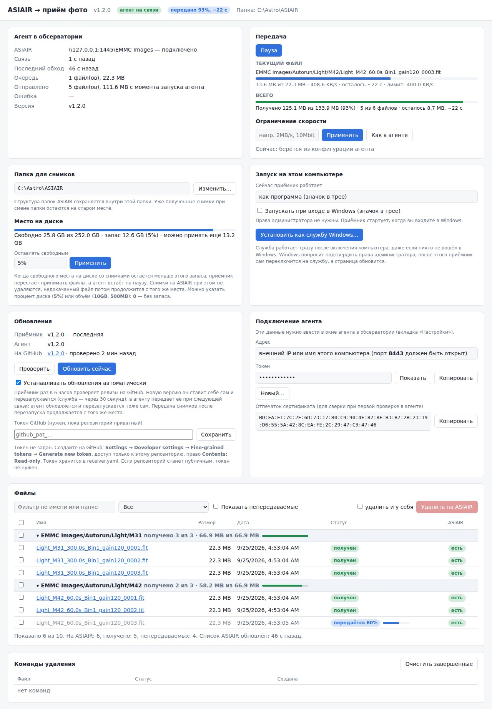

# asiair_transmit_photo

Две программы для удалённой обсерватории: снимки с **ASIAIR** сами передаются на ваш домашний компьютер через интернет. Там их можно посмотреть в браузере с авторастяжкой, отбраковать и удалить лишнее прямо на ASIAIR.

```
 Обсерватория (локальная сеть)                    Интернет                Дом
┌─────────┐   SMB (гость)   ┌──────────────────┐   HTTPS, лимит скорости  ┌─────────────────────┐
│ ASIAIR  │ ◄────────────── │ asiair-agent.exe │ ───────────────────────► │ asiair-receiver.exe │
│         │   удаление      │ (трей / служба)  │ ◄─── команды удаления ── │ + веб-страница      │
└─────────┘                 └──────────────────┘                          └─────────────────────┘
```

* **asiair-agent** (агент) работает на Windows-ПК в той же сети, что и ASIAIR. Он забирает новые снимки и отправляет их домой. Соединение всегда исходящее, поэтому в обсерватории не нужно открывать порты.
* Связь агента с приёмником — на выбор: **через интернет** (на домашнем роутере открыт порт) или **через Tailscale**, встроенный в обе программы (ничего открывать не нужно, работает и при «сером» IP, бесплатно).
* **asiair-receiver** (приёмник) работает на домашнем компьютере. Он складывает снимки в папку и показывает веб-страницу: список файлов, просмотр FITS, удаление на ASIAIR, настройки.



## Содержание

1. [Возможности](#возможности)
2. [Где взять программы](#где-взять-программы)
3. [Первая настройка](#первая-настройка)
   * [Шаг 1. Домашний компьютер: приёмник](#шаг-1-домашний-компьютер-приёмник)
   * [Шаг 2. Связь: интернет или Tailscale](#шаг-2-связь-интернет-или-tailscale)
   * [Шаг 3. ПК в обсерватории: агент](#шаг-3-пк-в-обсерватории-агент)
4. [Проверка, что всё работает](#проверка-что-всё-работает)
5. [Повседневная работа](#повседневная-работа)
6. [Файлы настроек](#файлы-настроек)
7. [Частые проблемы](#частые-проблемы)
8. [Как это устроено](#как-это-устроено)
9. [Разработка и тесты](#разработка-и-тесты)

## Возможности

* **Автоматическая передача** всех новых снимков (FITS, JPG, PNG, TIFF, XISF) с ASIAIR — из внутренней памяти (eMMC), с SD-карты и с флешки. Структура папок ASIAIR (`EMMC Images/Autorun/Light/M31/…`) и даты файлов сохраняются.
* **Логин к ASIAIR не нужен:** ASIAIR пускает гостя. Если прошивка требует логин, его можно указать.
* **Ограничение скорости** (по умолчанию `100MB/s`) выбирается бегунком с шагом 1 MB/s — в окне агента и на странице приёмника, меняется на лету. Скорость агента — потолок: приёмник может её только уменьшить.
* **Докачка:** при обрыве связи передача продолжается с места остановки, а не с начала.
* **Старт по кнопке:** новый приёмник сначала только показывает структуру ASIAIR, а передачу начинает кнопка «Старт» на его странице.
* **Пауза:** кнопка «Пауза» в окне агента, в меню значка или на странице приёмника останавливает передачу, «Продолжить» докачивает с того же места.
* **Скачать отдельные файлы или папку**, пока передача на паузе или ещё не запущена.
* **Синхронизация выбранных папок на паузе:** общая передача стоит, а выбранные папки продолжают приходить, включая новые кадры в них. Синхронизацию можно снять в любой момент.
* **Проверка целостности:** файл появляется у вас только после сверки SHA-256 всего файла.
* Недописанные кадры не передаются: файл уходит, когда перестал меняться.
* **Просмотр FITS в браузере** с авторастяжкой как STF в PixInsight, дебайеризацией цветных кадров и увеличением до полного разрешения.
* **Удаление на ASIAIR** с домашнего компьютера: отметить файлы и нажать кнопку или удалить папку целиком, со всеми подпапками. Команды со страницы (удаление, пауза, скорость, «Скачать») доходят до агента за секунду: он постоянно на связи.
* **С телефона:** та же страница, с вёрсткой под телефон и входом по паролю. Открывается через интернет (порт агента) или через Tailscale; через Tailscale её можно установить на главный экран как приложение.
* **Всё настраивается мышкой:**
  * у агента — окно с вкладкой «Настройки» и кнопками «Проверить»;
  * у приёмника — веб-страница с выбором папки, токеном и запуском с Windows.
* **Запуск вместе с Windows:** значок в трее при входе в систему или служба Windows, которая работает и без входа.
* **Связь без проброса портов:** встроенный Tailscale — агент и приёмник находят друг друга по имени даже при «сером» IP. Выбирается в настройках агента, включается галочкой на странице приёмника.
* **Безопасность:** HTTPS с проверкой сертификата по отпечатку плюс секретный токен. Страница приёмника по умолчанию открывается только на самом компьютере.

## Где взять программы

### Готовые программы

Готовые `.exe` лежат на странице **[Releases](https://github.com/arbalet1985/asiair_transmit_photo/releases/latest)** (справа на главной странице репозитория):

* `asiair-agent.exe` — для ПК в обсерватории;
* `asiair-receiver.exe` — для домашнего компьютера;
* `asiair-transmit-photo-…-windows.zip` — обе программы и примеры настроек одним архивом;
* `asiair-transmit-photo-…-linux-amd64.tar.gz` — версии для Linux.

Репозиторий приватный, поэтому релизы видны только тем, у кого есть к нему доступ.

### Обновления

Скачивать новые версии вручную нужно только один раз — чтобы поставить версию с автообновлением (1.2.0 или новее). Дальше программы обновляются сами:

1. Приёмник раз в 6 часов (и по кнопке «Проверить» на странице) смотрит последний релиз на GitHub.
2. Если вышла новая версия, приёмник скачивает её, проверяет контрольную сумму, заменяет свой `.exe` и перезапускается. Служба Windows запускается снова через 30 секунд, программа в трее — сразу.
3. Приёмник сообщает агенту о новой версии при следующей связи. В окне агента в строке «Версия» появляется кнопка **«Обновить до X»** (и такой же пункт в меню значка в трее), в трее всплывает уведомление, а на странице приёмника в строке «Версия агента» видно «доступна версия X — нажмите «Обновить» в окне агента». Сам агент без спроса не обновляется: после нажатия кнопки и подтверждения он скачивает `asiair-agent.exe` с приёмника по тому же защищённому каналу, что и снимки, проверяет контрольную сумму, заменяет себя и перезапускается (окно возвращается свёрнутым в трей). Агент, запущенный как служба Windows или из консоли (`asiair-agent run`), окна не имеет и обновляется сам, как раньше (если в `agent.yaml` не стоит `auto_update: false`).
4. Передача снимков после перезапуска продолжается с того же места.

**Страховка агента (с версии 1.9.0).** Обсерватория далеко, поэтому неудачное обновление не должно оставить агент выключенным:

* старая версия остаётся рядом с новой (`asiair-agent.old.exe`), а перед перезапуском агент запускает её копию как «сторожа» — в фоне, без окна;
* новая версия должна за 3 минуты (служба Windows — за 6) запуститься и связаться с приёмником. Тогда сторож завершается, а старая копия удаляется;
* если новая версия не запустилась, зависла или не выходит на связь, сторож останавливает её, возвращает старую версию на место и запускает её (службу снова запускает Windows). Перерыв в передаче — несколько минут;
* восстановленная версия больше не ставит неудачную: в окне агента и на странице приёмника в строке «Версия агента» видно «обновление до X не удалось (…), возвращена версия Y». Следующая, более новая версия ставится как обычно;
* если новую версию не удалось даже запустить, агент сразу возвращает старую, не дожидаясь сторожа;
* журнал сторожа — `asiair-agent-update.log` рядом с программой.

Страховка работает для обновлений *с* версии 1.9.0: переход на 1.9.0 со старых версий идёт по-старому.

Обновление не запрашивает разрешений: прав администратора не нужно (папка программы должна быть доступна для записи), SmartScreen не срабатывает (файл скачан самой программой, а не браузером). В режиме Tailscale брандмауэр Windows может один раз спросить про сетевой доступ — работа при этом не останавливается, при любом ответе.


Пока репозиторий приватный, приёмнику нужен токен GitHub только для чтения. Создайте его на GitHub: **Settings → Developer settings → Personal access tokens → Fine-grained tokens → Generate new token**, в **Repository access** выберите только этот репозиторий, в **Permissions → Contents** — **Read-only**. Вставьте токен на странице приёмника в блоке «Обновления» и нажмите «Сохранить». Токен хранится в `receiver.yaml` (параметр `update_token`); агенту он не нужен.

Версии видны: у приёмника — в шапке страницы («приёмник v…») и в блоке «Обновления»; у агента — в окне («Версия» на вкладке «Состояние») и на странице приёмника: в шапке («агент v… на связи»), первой строкой раздела «Агент в обсерватории» и в блоке «Обновления».

Автообновление выключается галочкой «Устанавливать обновления автоматически» на странице приёмника (тогда обновляет кнопка «Обновить сейчас») или параметром `auto_update: false` в `agent.yaml` для агента, работающего службой или из консоли (агент с окном всегда ждёт кнопку «Обновить»). Программы, собранные вручную (`build.cmd`), имеют версию «dev» и сами не обновляются. Папка с программой должна быть доступна для записи — не ставьте её в `C:\Program Files`.

### Выпуск новой версии

Программы собирает GitHub Actions (файл `.github/workflows/release.yml`), в репозиторий `.exe` не добавляются.

1. На GitHub откройте **Releases → Draft a new release**.
2. В **Choose a tag** введите новый номер версии с буквой `v`, например `v1.2.0`, и выберите **Create new tag on publish**.
3. Нажмите **Generate release notes** (список изменений соберётся сам) и **Publish release**.
4. Через 2–3 минуты к релизу добавятся готовые файлы. Ход сборки виден на вкладке **Actions**. Номер версии попадает в программы, и в течение 6 часов приёмник и агент обновятся сами (или сразу — кнопкой «Обновить сейчас» на странице приёмника).

То же без создания тега вручную: **Actions → Release → Run workflow**, в поле номера версии введите `v1.2.0` и нажмите **Run workflow** — тег и релиз создадутся сами. Или из командной строки: `git tag v1.2.0 && git push origin v1.2.0`.

Пробная сборка без релиза: **Actions → Release → Run workflow** с пустым номером версии. Файлы появятся внизу страницы запуска в разделе **Artifacts** и хранятся 7 дней.

Сборка занимает 1–2 минуты из бесплатных минут GitHub Actions (для приватного репозитория на бесплатном тарифе — 2000 минут в месяц). Если минуты закончатся и карта к аккаунту не привязана, сборка просто не запустится до следующего месяца, денег не спишут.

### Сборка самостоятельно

Программы написаны на Go и собираются в два `.exe` без зависимостей.

#### В Windows

1. Установите Go 1.26 или новее: https://go.dev/dl/ (установщик `.msi`, всё по умолчанию).
2. Скачайте исходники: на GitHub кнопка **Code → Download ZIP**, распакуйте. Или выполните `git clone https://github.com/arbalet1985/asiair_transmit_photo.git`.
3. В папке с исходниками запустите **`build.cmd`** двойным щелчком или из командной строки.
4. Готовые программы появятся в папке **`dist\`**:
   * `asiair-agent.exe` — для ПК в обсерватории;
   * `asiair-receiver.exe` — для домашнего компьютера;
   * `agent.example.yaml`, `receiver.example.yaml` — примеры настроек. Они не обязательны: обе программы создают настройки сами.

#### В Linux или macOS (сборка для Windows)

```sh
./build.sh      # dist/*.exe для Windows и бинарники для Linux
```

Вручную: `GOOS=windows GOARCH=amd64 go build -o asiair-agent.exe ./cmd/asiair-agent`.

Иконки и манифест Windows (нужны окну и значку в трее) уже лежат в репозитории, в файлах `cmd/*/rsrc_windows_*.syso`. Ничего дополнительно ставить не нужно.

## Первая настройка

Порядок важен: сначала домашний компьютер, потому что агенту понадобятся токен и адрес приёмника.

### Шаг 1. Домашний компьютер: приёмник

1. Скопируйте `asiair-receiver.exe` в отдельную папку, например `C:\ASIAIR-Receiver\`, и запустите двойным щелчком.
2. Приёмник спрячется в трей (зелёный круглый значок-телескоп; у агента значок синий квадратный) и откроет в браузере страницу **http://127.0.0.1:8080**. При первом запуске он сам создаёт `receiver.yaml` со случайным токеном: токена «по умолчанию» нет, у каждой установки он свой.
3. На странице:
   * **«Папка для снимков» → «Изменить…»** — выберите диск и папку, куда складывать снимки. Можно создать новую папку или вписать путь вручную.

     

   * **«Запуск на этом компьютере»** — выберите одно из двух:
     * галочка **«Запускать при входе в Windows»** — приёмник стартует значком в трее, когда вы входите в систему. Права администратора не нужны;
     * кнопка **«Установить как службу Windows…»** — приёмник работает сразу после включения компьютера, даже если никто не вошёл. Windows попросит подтвердить права администратора, приёмник сам переключится на службу, а страница обновится. Кнопка «Удалить службу…» возвращает всё назад.

     

   * **«Подключение агента»** — здесь токен (кнопки «Показать» и «Копировать») и отпечаток сертификата. Они понадобятся на шаге 3: токен вставляется в окне агента в поле «Токен». Кнопка «Новый…» создаёт другой токен — после этого его нужно заново вписать в агент.

Щелчок по значку приёмника в трее открывает страницу. В меню значка есть «Выход».

### Шаг 2. Связь: интернет или Tailscale

Выберите один из двух способов. Если не уверены — берите **Tailscale**: ничего не нужно настраивать на роутере.

| | Через интернет | Через Tailscale |
|---|---|---|
| Роутер дома | нужен проброс порта 8443 | ничего не нужно |
| «Серый» IP у провайдера | не работает | работает |
| Внешний IP / DuckDNS | нужен | не нужен |
| Учётная запись | не нужна | Tailscale (Google, Microsoft, GitHub, Apple или e-mail) |
| Стоимость | бесплатно | бесплатно для личного использования |

#### Вариант А: через интернет (проброс порта)

Агент подключается к приёмнику на **порт 8443** (HTTPS). Новый приёмник этот порт сам не открывает — включите его:

1. **На странице приёмника** в блоке «Подключение агента» отметьте **«Принимать агента через интернет (порт 8443)»**. Приёмник предложит добавить разрешение в **брандмауэр Windows** — согласитесь и нажмите «Да» в запросе прав администратора. Тогда Windows больше не спросит «Разрешить доступ к сети?». Строка «Брандмауэр Windows: разрешено ✓» показывает, что всё в порядке; кнопка «Разрешить…» рядом добавляет разрешение позже.
2. **Роутер:** проброс порта (Port Forwarding / Virtual Server): внешний TCP 8443 → внутренний IP домашнего компьютера, порт 8443. Домашнему компьютеру лучше закрепить постоянный IP в настройках DHCP роутера.
3. **Внешний адрес:** узнайте внешний IP (например, на https://2ip.ru). Если провайдер меняет IP, заведите бесплатное имя в сервисе динамического DNS (DuckDNS, No-IP) и используйте его.

> **«Серый» IP** (адрес за общим NAT провайдера): проброс порта не поможет — используйте вариант Б.

Порт 8080 (веб-страница) наружу открывать **не нужно**.

#### Вариант Б: через Tailscale (без проброса портов)

[Tailscale](https://tailscale.com) — защищённая частная сеть между вашими устройствами. Он **встроен** в обе программы: отдельно ставить приложение Tailscale не нужно. Бесплатного тарифа Personal хватает с запасом: до 6 пользователей и неограниченное число устройств.

1. **На странице приёмника** в блоке «Подключение агента» отметьте **«Принимать агента через Tailscale»** (приёмник предложит разрешение в брандмауэре, как в варианте А; «Отмена» тоже работает — Windows просто спросит сама). Галочку «Принимать агента через интернет» можно не ставить: порт 8443 тогда вообще не открывается. Появится кнопка **«Войти в Tailscale…»**: нажмите её и войдите удобным способом (Google, Microsoft, GitHub, Apple или e-mail). При первом входе Tailscale сам создаст бесплатную учётную запись.
2. Через несколько секунд на странице появится «Подключено… имя asiair-receiver» и **адрес приёмника для агента**, например `asiair-receiver, порт 8443`.
3. **В окне агента** (шаг 3) выберите «Способ связи: **Через Tailscale**», в поле «Адрес» впишите `asiair-receiver`, порт `8443`, токен — как обычно. Нажмите «Сохранить и применить».
   При сохранении агент предложит добавить разрешение в брандмауэр Windows (для Tailscale он открывает сетевой порт) — «Да» и подтверждение прав администратора, чтобы Windows не спрашивала сама. «Нет» тоже можно: агент работает и без него.
4. На вкладке «Состояние» агента появится строка «Tailscale» и кнопка **«Войти в Tailscale…»**: войдите **той же учётной записью**, что и на приёмнике. Значок в трее тоже напомнит о входе.
5. Вернитесь на вкладку «Настройки» и нажмите «Проверить» у приёмника — должно появиться «OK».

Вход нужен один раз: программы запоминают его (агент — в папке `tailscale` рядом с `agent.yaml`, приёмник — в `receiver-data\tailscale`) и после перезапуска или обновления подключаются сами. Если на ПК в обсерватории неудобно входить через браузер, создайте ключ на [login.tailscale.com](https://login.tailscale.com/admin/settings/keys) (**Settings → Keys → Generate auth key**) и вставьте его в поле «Ключ Tailscale» агента — тогда вход не нужен.

Имя может получить суффикс (`asiair-receiver-1`), если такое имя в вашей сети Tailscale уже занято: точное имя всегда видно на странице приёмника. Вместо имени можно указать адрес `100.x.x.x` оттуда же. Сертификат и токен работают как обычно, обычное подключение через интернет при этом тоже продолжает работать.

Совет: ключи и устройства Tailscale по умолчанию требуют повторного входа раз в 180 дней. Чтобы обсерватория не потеряла связь, в [панели Tailscale](https://login.tailscale.com/admin/machines) у обоих устройств выберите **… → Disable key expiry**.

### Шаг 3. ПК в обсерватории: агент

1. Скопируйте `asiair-agent.exe` в папку, например `C:\ASIAIR-Agent\`, и запустите двойным щелчком. Откроется окно агента на вкладке **«Настройки»**.

   

2. **Откуда брать снимки** (верхний блок вкладки «Настройки»). Проще всего нажать кнопку **«Найти в сети…»** под полем «Путь»: агент просканирует локальную сеть обсерватории (до /24 на каждом подключении) и сам заполнит поля.
   * **ASIAIR** узнаётся по гостевой шаре `EMMC Images`: путь станет `\\IP\EMMC Images`, логин и пароль останутся пустыми.
   * **StellaVita** узнаётся по входу `as` / `astrostation`: путь станет `\\IP\Astrostation`, логин и пароль подставятся сами.
   * Если найдено несколько устройств, агент спросит, какое использовать. Если ничего не найдено — проверьте, что компьютер в той же сети, и впишите адрес вручную.

   Вручную: в поле **«Путь»** введите IP ASIAIR (виден в приложении ASIAIR в настройках Wi-Fi/LAN), например `192.168.1.50`, или путь `\\192.168.1.50\EMMC Images`. Логин и пароль для ASIAIR не нужны.

   Затем нажмите **«Проверить»** справа от пути: должно появиться «OK: вход: гость (guest), шары: EMMC Images, …» — в списке будут все хранилища ASIAIR, в том числе SD-карта и флешка, если они вставлены.

   **Если ASIAIR сменил адрес** (например, роутер обсерватории выдал ему другой IP), агент найдёт его сам: когда ASIAIR не отвечает по сохранённому пути сразу после запуска (или три обхода подряд позже), агент в фоне ищет в сети устройство того же типа — ASIAIR или StellaVita. Если оно отвечает, агент меняет в пути только адрес, сохраняет его в `agent.yaml` и продолжает работу; если не найдено — путь остаётся прежним, поиск повторится не раньше чем через 10 минут. Если в сети несколько ASIAIR, агент выберет только тот, на котором есть уже переданные им снимки; иначе путь не меняется и в журнале будет список найденных адресов. Папки и флешки (`dir:`, `usb:`) не ищутся.

   **Флешка вместо сети.** Если снимки удобнее забрать с флешки, выньте её из ASIAIR и вставьте в компьютер с агентом, затем нажмите **«Флешка…»** и **«Сохранить и применить»**. Путь станет `usb:`: агент читает первую вставленную флешку, какая бы буква диска ей ни досталась (`usb:E:\` — только диск E:). Файлы получают те же пути, что и с шары `Udisk` ASIAIR, поэтому уже полученное по сети обычно не скачивается заново (если время файлов на флешке совпадает с тем, что отдавал ASIAIR). Кнопка «Нет» в вопросе позволяет выбрать диск или любую папку вручную. Чтобы вернуться к ASIAIR, снова укажите его адрес или нажмите «Найти в сети…».
3. **Приёмник:**
   * **Способ связи** — «Через интернет» или «Через Tailscale» (см. шаг 2);
   * **Адрес** — внешний IP или имя домашнего компьютера из шага 2, а для Tailscale — имя приёмника в Tailscale (`asiair-receiver`);
   * **Порт** — 8443;
   * **Токен** — скопируйте со страницы приёмника.

   Нажмите **«Проверить»**. При первой проверке появится окно с отпечатком сертификата: сверьте его с отпечатком на странице приёмника и нажмите «Да». Должно появиться «OK: Приёмник доступен, токен и сертификат подходят».

   **«Проверить» сначала проверяет сетевой доступ:** находится ли имя, какой у него IP и отвечает ли порт (8443 у приёмника, 445 у ASIAIR). Если нет, окно скажет, на каком шаге остановилось и что проверить: «порт не отвечает» — пакеты не доходят (проброс на роутере, брандмауэр Windows на компьютере с приёмником, белый IP, сеть обсерватории), «порт закрыт» — адрес отвечает, но приёмник там не слушает. Если в адресе приёмника не указан порт, используется 8443.

   Сохранить настройки можно и тогда, когда приёмник или ASIAIR сейчас недоступны: «Сохранить и применить» ничего не проверяет по сети. Если отпечаток при этом остался пустым, агент запомнит сертификат приёмника при первом удачном подключении, запишет отпечаток в `agent.yaml` и в журнал — сверьте его со страницей приёмника.
4. Отметьте **«Запускать автоматически при входе в Windows»** и, если хотите, **«Запускать свёрнутым в трей»**.
5. Нажмите **«Сохранить и применить»**. Агент перезапустится и начнёт передачу.

Если ПК в обсерватории после перезагрузки остаётся без входа в систему, вместо автозагрузки поставьте агента службой из командной строки **от имени администратора**: `asiair-agent.exe install`, затем `asiair-agent.exe start`. Окна и значка в трее у службы нет, журнал пишется в `asiair-agent.log`.

## Проверка, что всё работает

1. **Окно агента, вкладка «Состояние»:**
   * «ASIAIR — подключено»;
   * «Приёмник — на связи»;
   * очередь файлов, если на ASIAIR есть новые снимки.

   

2. **Страница приёмника:** значок «агент на связи», в «Файлах» появился список с ASIAIR. Пока передача не запущена, в заголовке написано «передача не запущена», а у файлов — «ждёт старта».
3. **Старт:** нажмите «Старт» в разделе «Передача». Агент начнёт передавать все снимки; полученные файлы помечаются «получен». Если нужны не все, вместо «Старт» скачайте отдельные файлы или папки (см. «Страница приёмника»).
4. **Пробная передача:** сделайте на ASIAIR короткий тестовый кадр. Примерно через 1–2 минуты он появится в папке для снимков (агент ждёт 30 с, пока файл перестанет меняться, и проверяет ASIAIR раз в минуту).
5. **Пробное удаление:** на странице приёмника отметьте тестовый кадр и нажмите «Удалить на ASIAIR». В «Командах удаления» статус станет «удалено», а кадр исчезнет из галереи ASIAIR.
6. **Докачка:** во время передачи большого файла выдерните сетевой кабель на полминуты. После восстановления связи агент продолжит с того места, где остановился: в журнале будет «продолжение с … из …».
7. **Из командной строки агента:** `asiair-agent.exe check` проверяет связь с ASIAIR и приёмником и показывает, как удалось войти в ASIAIR.

Журналы: `asiair-agent.log` и `asiair-receiver.log` рядом с программами. В окне агента есть кнопка «Открыть журнал».

Каждый день журнал начинается заново, прошлые дни лежат рядом: `asiair-agent-2026-09-24.log`. Если за день журнал вырос больше 50 МБ, он продолжается в `…-2026-09-24-2.log`. Дни старше 3 дней сжимаются в `.gz`, их открывает любой архиватор (7-Zip, WinRAR). Дни старше 7 дней удаляются. Сроки задаются в `agent.yaml` и `receiver.yaml` параметрами `log_compress_after` и `log_keep` и применяются после перезапуска программы.

## Повседневная работа

### Окно агента

* Кнопки «Свернуть» и крестик убирают окно в трей, передача продолжается. Окно открывается щелчком по значку или повторным запуском `.exe`.
* **Цвет значка:**
  * зелёный — всё на связи;
  * синий — идёт передача;
  * жёлтый — передача на паузе;
  * красный — нет связи с ASIAIR или приёмником;
  * серый — не заполнены настройки.
* **Пауза / Продолжить** (кнопка в окне и пункт меню значка): останавливает передачу. Текущий файл прерывается, а после «Продолжить» докачивается с того же места. Пока стоит пауза, агент по-прежнему обходит ASIAIR, отправляет список файлов и выполняет удаление со страницы приёмника. Пауза запоминается и остаётся после перезапуска программы. Приёмник показывает «пауза» на своей странице. У агента, работающего как служба Windows, окна нет — его можно поставить на паузу со страницы приёмника.

  В строке «Передаётся» видно, где включена пауза: «пауза — нажмите «Продолжить»» (в окне агента) или «пауза на приёмнике».

  
* **Меню значка:** «Открыть окно», «Настройки», «Пауза», «Перезапустить агент», «Выход».

  

### Страница приёмника

* **Старт** (раздел «Передача»): новый приёмник не даёт агенту передавать снимки, пока не нажата эта кнопка. До этого страница показывает только структуру ASIAIR: в заголовке «передача не запущена», у файлов — «ждёт старта». Агент в это время пишет «ждёт «Старт» на странице приёмника». После «Старт» кнопка становится «Пауза». Если приёмник обновлён со старой версии, передача продолжается как раньше, без «Старт».
* **Скачать отдельный файл или папку:** пока передача на паузе или ещё не запущена, у каждого непереданного файла есть кнопка «⤓ Скачать», у папки — «⤓ Скачать папку», а для отмеченных галочками файлов — «Скачать выбранные». Запрошенные файлы помечаются «запрошен» (✕ отменяет запрос), агент передаёт их, не снимая паузу, и потом снова ждёт. Когда передача идёт, кнопки у файлов и папок скрыты, а «Скачать выбранные первыми» передаёт отмеченные файлы раньше остальных.

  

* **Пауза / Продолжить** (раздел «Передача»): ставит передачу на паузу из дома. Агент получает её при следующей связи (обычно через несколько секунд), прерывает текущий файл и потом докачивает его с того же места. Пауза на приёмнике и пауза в окне агента независимы: передача идёт, только когда обе сняты. Пауза сохраняется после перезапуска приёмника. Если пауза нажата в окне агента, рядом с кнопкой написано «пауза включена в окне агента — снимается там».

  
* **Файлы:** вся структура ASIAIR, сгруппированная по папкам. Уже полученные файлы показаны обычным цветом, ещё не полученные — серым. У каждого файла статус:

  | Статус | Что значит |
  |---|---|
  | получен | файл у вас, совпадает с ASIAIR |
  | передаётся 45% | передаётся сейчас, с мини-полосой прогресса |
  | прервано на 60%, докачка в 21:14 | связь оборвалась; продолжится с этого места |
  | ошибка, повтор в 21:14 | попытка не удалась, агент повторит сам (причина во всплывающей подсказке) |
  | в очереди | ждёт своей очереди |
  | записывается на ASIAIR | файл ещё меняется; уйдёт, когда запись закончится |
  | изменён на ASIAIR | на ASIAIR другая версия, она будет передана заново |
  | только у меня | на ASIAIR файла уже нет |
  | удаляется | ждёт выполнения команды удаления |
  | не передаётся (фильтр) | миниатюры, журналы и т. п.; видны при включённой галочке «Показать непередаваемые» |

  У заголовка папки — «получено 3 из 10 · 1,2 из 3,4 ГБ» и полоса прогресса папки.

  **Фильтры** (запоминаются в браузере, «Сбросить фильтры» показывает всё):
  * по имени или папке;
  * по состоянию: «На ASIAIR / Получены и есть на ASIAIR / Ещё не получены / С ошибками / Только у меня»;
  * по **хранилищу**: внутренняя память, SD-карта, флешка — с числом файлов в каждом;
  * по **типу**: FITS, JPG, PNG, TIFF, XISF;
  * по **дате съёмки**: «с» и «по» (включительно); кнопка «Последняя ночь» ставит даты самой свежей ночи.

  **Панель фильтров и кнопок закреплена сверху:** при прокрутке длинного списка она остаётся на экране. Щелчок по «▾ Фильтры» сворачивает поля фильтров в одну строку-сводку («FITS · SD-карта · с 24.09 — показано 120 из 3400»); кнопки выбора, скачивания и удаления остаются видны. Выбор запоминается.

  **Папки:** «Свернуть все» / «Развернуть все»; какие папки свёрнуты, тоже запоминается.

  **Синхронизация папки на паузе.** Кнопка «⟳ Синхронизировать на паузе» в строке папки открывает окно выбора: эта папка или любая папка выше (например, `Autorun/Light` — все цели сразу). Файлы выбранной папки и всех её подпапок передаются, даже когда передача на паузе или ещё не запущена, в том числе новые кадры, которые появятся в ней позже. Остальные файлы ждут снятия паузы. Синхронизируемые папки показаны над списком файлов («На паузе синхронизируются: …, ждут: N»). Кнопка ✕ там или в строке папки снимает синхронизацию: ещё не переданные файлы этой папки снова ждут снятия паузы. Работает с агентом любой версии: приёмник сам запрашивает у агента новые файлы этих папок.

  **Скачать по фильтру.** Например, только FITS с SD-карты: выберите хранилище и тип, нажмите «Выбрать все найденные» (отмечаются все показанные файлы, в том числе в свёрнутых папках), затем «Скачать выбранные». На паузе они передаются, не снимая паузу; во время передачи — раньше остальных.
* **Передача:**
  * «Передаются (3)» — каждый файл, который идёт сейчас, со своей полосой и «12,3 из 28,6 МБ»; под ними общая скорость, сколько осталось этим файлам и лимит;
  * «Диагностика» — во что упирается передача: в чтение с ASIAIR, в сеть до приёмника или в лимит скорости, с долями времени («время: ASIAIR 10%, сеть 85%, лимит 5%»). В режиме Tailscale добавляется, идёт ли связь напрямую или через ретранслятор (ретранслятор обычно даёт не больше 1–2 МБ/с). То же видно в окне агента на вкладке «Состояние», строка «Диагностика»;
  * «Всего» — полоса по всем снимкам на ASIAIR: «Получено 1,2 из 3,4 ГБ (35%) · 12 из 40 файлов · осталось 2,2 ГБ, ~1 ч 32 мин»;
  * в шапке страницы — короткое «передано 35%».

  В окне агента на вкладке «Состояние» тоже две полосы: первый из передаваемых файлов (рядом — «и ещё N») и «Всего».
* **Удаление на ASIAIR:**
  * отметьте файлы или целые папки галочками и нажмите «Удалить на ASIAIR»;
  * **папка целиком:** кнопка «🗑 Удалить папку» в строке папки. В окне выберите эту папку или любую папку выше (например, `Autorun/Light/M31` вместе со всеми ночами). Удаляется всё: файлы любых типов, в том числе скрытые фильтрами и не передаваемые, вложенные и пустые папки, сама папка. Удалить хранилище целиком (`EMMC Images`) нельзя. С галочкой «удалить и у себя» папка удаляется и на этом компьютере. Нужен агент версии 1.11.0 или новее: он обновится сам, у старого агента команда завершится ошибкой «неизвестная команда»;
  * **«Удалить полученные на ASIAIR (N)»** освобождает место на ASIAIR: удаляет только файлы, которые уже получены и сверены по контрольной сумме, с учётом фильтров (например, только FITS с SD-карты за прошлую ночь). Копии на этом компьютере остаются;
  * перед удалением окно показывает, сколько файлов и какой объём будет удалён, по каждому хранилищу, и предупреждает, если среди выбранных есть ещё не полученные файлы — их после удаления не останется нигде;
  * «удалить и у себя» сразу удаляет и локальные копии;
  * команда уходит агенту сразу (агент постоянно на связи) и выполняется за секунду-две, результат виден в «Командах удаления». Если агент сейчас не на связи, команда выполнится, как только он подключится.
* **Одновременно файлов** (1–8, по умолчанию 3): сколько файлов агент передаёт параллельно, каждый по своему соединению. Помогает, когда один поток не набирает скорость канала — при большой задержке, потерях или ретрансляторе Tailscale. Если диагностика показывает, что упирается в чтение с ASIAIR или в отдачу интернета, больше потоков не ускорит. Лимит скорости общий на все потоки. Агент старой версии передаёт по одному файлу.
* **Ограничение скорости:** бегунок от 1 до 100 MB/s с шагом 1 MB/s, крайнее правое положение — без ограничения. Значение применяется, когда бегунок отпущен (стрелками на клавиатуре — по 1 MB/s). Быстрее, чем задано в агенте, агент всё равно не отправляет, поэтому часть шкалы правее скорости агента серая и бегунок туда не заходит; бегунок в самом правом доступном положении означает «как в агенте». Поднять потолок можно бегунком «Скорость передачи» в окне агента (вкладка «Состояние»). С агентом до этой версии значение на странице, как раньше, заменяет его собственное.
* **Доступ агента к ASIAIR** (блок «Агент в обсерватории», строка «ASIAIR»): метка «доступен» или «недоступен», адрес ASIAIR и путь к нему, когда был последний обход; если ASIAIR недоступен — текст ошибки, время последнего удачного обхода и пометка «агент ищет ASIAIR в сети», пока идёт автопоиск. В шапке страницы при этом появляется «ASIAIR недоступен».
* **Компактный вид:** блок «Настройки» (папка, диск, запуск, обновления, подключение агента) сворачивается целиком в одну строку со сводкой — «папка … · свободно … · Tailscale: подключён · приёмник v…». Каждую панель, в том числе «Агент в обсерватории» и «Передача», можно свернуть щелчком по её заголовку. Выбор запоминается; после первого подключения агента настройки открываются свёрнутыми.
* **Обновления:** версия приёмника и агента, последняя версия на GitHub, кнопки «Проверить» и «Обновить сейчас», галочка автообновления и поле для токена GitHub. Подробнее — в разделе [Обновления](#обновления).
* **Место на диске:** показывает свободное место на диске со снимками. В поле «Оставлять свободным» задаётся запас (`5%` по умолчанию, можно `10GB`, `500MB` или `0`). Когда места остаётся меньше запаса, приёмник перестаёт принимать файлы, в шапке появляется «мало места на диске», а агент встаёт на паузу. Снимки на ASIAIR не удаляются; когда место освободится или запас уменьшится, передача продолжится сама, недокачанный файл — с того же места.

### С телефона

Страницу приёмника можно открыть на телефоне (или на другом компьютере): видно, как идёт передача, можно поставить на паузу, запустить, скачать или синхронизировать папку, посмотреть кадры (листаются смахиванием) и удалить лишнее на ASIAIR. Вёрстка на телефоне своя: файлы — карточками, кнопки крупные, фильтры свёрнуты.

Настройка — на домашнем компьютере, в блоке **«Доступ с телефона»** (в «Настройках»):

1. **Задайте пароль** (не меньше 8 символов). Без пароля войти с телефона нельзя. В `receiver.yaml` хранится только его хеш. Новый пароль выводит из системы все телефоны.
2. **Включите один или оба способа:**
   * **Через интернет.** Страница открывается на том же порту, что и для агента: `https://<внешний адрес>:8443/`. Порт уже проброшен на роутере, если агент подключается через интернет (галочка «Принимать агента через интернет» должна быть включена). Сертификат у приёмника самоподписанный, поэтому телефон при первом входе предупредит о нём: это нормально, соединение зашифровано, подтвердите один раз. На главный экран страницу можно добавить как ярлык (она откроется в браузере).
   * **Через Tailscale.** На телефон ставится приложение Tailscale (App Store / Google Play) и входит в **ту же** учётную запись, что и приёмник. Адрес страницы показан в блоке: `https://asiair-receiver.<ваша-сеть>.ts.net/`. Чтобы у этого адреса был настоящий сертификат, один раз включите в панели Tailscale (login.tailscale.com → **DNS**) **MagicDNS** и **HTTPS Certificates**; первый сертификат выдаётся за минуту-две. Тогда страницу можно установить на главный экран как приложение: в Chrome — меню → «Установить приложение», в Safari — «Поделиться» → «На экран „Домой“». Пока HTTPS не включён, страница открывается по `http://asiair-receiver/` (трафик всё равно шифрует Tailscale), но установить её как приложение нельзя. Из интернета эта страница не видна вовсе.
3. На телефоне откройте адрес и введите пароль. Вход запоминается на 90 дней, обновления и перезапуски приёмника его не сбрасывают. Кнопка «Выйти» — в шапке страницы, «Выйти на всех телефонах» — на домашнем компьютере.

**Безопасность.** С телефона не меняются настройки домашнего компьютера: папка для снимков, служба и автозапуск, токен агента, сеть, Tailscale, пароль, токен GitHub; эти блоки на телефоне не показываются. После 5 неверных паролей с одного адреса вход с него закрыт на 15 минут, каждая неверная попытка замедляется. Попытки входа пишутся в журнал приёмника.

**Трафик.** Список файлов и превью передаются в сжатом виде, а пока страница свёрнута или экран телефона выключен, она ничего не запрашивает.

### Просмотр снимков

Щелчок по имени полученного файла открывает окно просмотра:


* **Авторастяжка** работает как STF в PixInsight. Чёрная точка ставится по медиане и разбросу фона, полутона выводят фон на заданную яркость. Без растяжки сырой кадр почти чёрный:

  

* **Цветные кадры** (`BAYERPAT` в заголовке) дебайеризуются.
  * «Каналы вместе» выключено: каналы растягиваются раздельно, это убирает зелёный перекос цветной камеры.
  * Включено: все каналы растягиваются одинаково.
* **Ползунки** «Чёрная точка», «Яркость фона» и «Белая точка» пересчитывают картинку сразу. «Сбросить» возвращает авторастяжку по умолчанию.
* **Щелчок по кадру** увеличивает его: догружается полное разрешение, место щелчка оказывается по центру. Повторный щелчок возвращает вписанный вид.

  

* **Отбраковка ночи:** ← → листают кадры, **Delete** отмечает кадр для удаления на ASIAIR. Кнопка «Удалить отмеченные на ASIAIR» удаляет все отмеченные разом.
* **Сбоку** — данные из заголовка FITS: объект, выдержка, gain, температура, фильтр, камера, дата.
* JPG и PNG открываются в том же окне.

## Файлы настроек

Обе программы хранят настройки в YAML-файле рядом с `.exe`. Основное настраивается мышкой, а остальное можно поменять в файле (у агента — кнопка «Файл настроек…») и перезапустить программу.

### `agent.yaml` (агент)

| Параметр | По умолчанию | Что это |
|---|---|---|
| `asiair` | — | Путь к ASIAIR: `192.168.1.50`, `\\192.168.1.50\EMMC Images`, `smb://логин:пароль@IP/шара`, `dir:Z:\` (уже подключённый диск), `usb:` (флешка из ASIAIR в этом компьютере) |
| `shares` | `["*"]` | Какие шары обходить, если в пути шара не указана (или указана `EMMC Images`). `*` — все хранилища ASIAIR: внутренняя память, SD-карта, флешка; список берётся у ASIAIR при каждом обходе, так что вставленная позже карта подхватится сама. Старое значение `["EMMC Images", "Udisk"]` работает так же, как `*`. Только внутренняя память: `["EMMC Images"]` |
| `username`, `password` | пусто | Логин к ASIAIR, обычно не нужен |
| `receiver_url` | — | Адрес приёмника, `https://адрес:8443` |
| `token` | — | Токен приёмника |
| `receiver_fingerprint` | — | Отпечаток сертификата приёмника, заполняется кнопкой «Проверить» |
| `connection` | `internet` | Способ связи с приёмником: `internet` или `tailscale` |
| `tailscale_hostname` | `asiair-agent` | Имя агента в Tailscale |
| `tailscale_authkey` | пусто | Ключ Tailscale вместо входа через браузер (необязательно) |
| `tailscale_control_url` | пусто | Свой сервер Headscale вместо Tailscale (для опытных) |
| `max_rate` | `100MB/s` | Ограничение скорости; `0` — без ограничения. Меняется бегунком в окне агента; страница приёмника может его только уменьшить |
| `extensions` | `.fit .fits .jpg .png .tif .xisf` | Какие файлы передавать |
| `exclude_extensions` | — | Какие расширения не передавать никогда, например `[".txt", ".log"]`. Действует и при пустом `extensions` (все файлы) |
| `exclude` | `Thumbnail` | Какие папки пропускать |
| `scan_interval` | `1m` | Как часто искать новые файлы |
| `poll_interval` | `15s` | Как часто агент сообщает приёмнику своё состояние. Команды (удаление, пауза, скорость, «Скачать») приходят сразу, не дожидаясь этого интервала |
| `min_file_age` | `30s` | Файл отправляется, только если не менялся столько времени |
| `state_file`, `log_file` | `agent-state.json`, `asiair-agent.log` | Список переданных файлов и журнал |
| `log_keep` | `7d` | Сколько хранить журналы прошлых дней: `7d`, `36h`; `0` — не удалять |
| `log_compress_after` | `3d` | Через сколько сжимать журналы прошлых дней в `.gz`; `0` — сразу |
| `auto_update` | `true` | Ставить новую версию агента, которую передаёт приёмник, без спроса — для службы и консоли. Агент с окном всегда ждёт кнопку «Обновить» |

### `receiver.yaml` (приёмник)

| Параметр | По умолчанию | Что это |
|---|---|---|
| `listen` | `:8443` | Порт для агента (открыть на роутере) |
| `internet` | `false` у нового приёмника | Принимать агента через интернет на порту `listen`. Меняется галочкой на веб-странице. Если параметра нет (настройки старых версий) — `true` |
| `ui_listen` | `127.0.0.1:8080` | Адрес веб-страницы. Для доступа из домашней сети: `0.0.0.0:8080`, тогда обязательно задайте `ui_user` и `ui_password` |
| `ui_user`, `ui_password` | пусто | Пароль на веб-страницу |
| `remote_internet` | `false` | Страница с телефона через интернет, на порту `listen`. Меняется на веб-странице |
| `remote_tailscale` | `false` | Страница с телефона через Tailscale. Меняется на веб-странице |
| `remote_password` | пусто | Хеш пароля для входа с телефона. Задаётся на веб-странице |
| `token` | создаётся сам | Токен для агента |
| `dest_dir` | `photos` | Папка для снимков, выбирается на странице |
| `data_dir` | `receiver-data` | Сертификат и служебное состояние |
| `tls_cert`, `tls_key` | пусто | Свой сертификат вместо самоподписанного |
| `disable_tls` | `false` | Отключить HTTPS (только при связи через VPN) |
| `max_rate` | пусто | Начальное ограничение скорости для агента (не выше скорости агента); дальше меняется бегунком на странице |
| `min_free` | `5%` | Сколько места оставлять свободным на диске со снимками: `5%`, `10GB`, `500MB`, `0` — без запаса. Меняется и на веб-странице |
| `log_file` | `asiair-receiver.log` | Журнал |
| `log_keep`, `log_compress_after` | `7d`, `3d` | Сколько хранить журналы прошлых дней и через сколько сжимать их в `.gz` (как у агента) |
| `auto_update` | `true` | Проверять релизы на GitHub, обновлять приёмник и передавать новую версию агенту. Меняется и на веб-странице |
| `update_token` | пусто | Токен GitHub только для чтения — нужен, пока репозиторий приватный. Задаётся на веб-странице |
| `update_repo` | `arbalet1985/asiair_transmit_photo` | Репозиторий с релизами |
| `tailscale` | `false` | Принимать агента через Tailscale. Меняется галочкой на веб-странице |
| `tailscale_hostname` | `asiair-receiver` | Имя приёмника в Tailscale |
| `tailscale_authkey` | пусто | Ключ Tailscale вместо входа через браузер (необязательно) |
| `tailscale_control_url` | пусто | Свой сервер Headscale вместо Tailscale (для опытных) |

### Команды

| Команда | Действие |
|---|---|
| (без команды) | в Windows: окно агента / приёмник в трее |
| `run` | запуск в консоли |
| `install` / `uninstall` | установить / удалить службу (от имени администратора); при установке добавляется разрешение в брандмауэр Windows |
| `firewall-allow` | добавить разрешение в брандмауэр Windows (от имени администратора) |
| `start` / `stop` / `restart` / `status` | управление службой |
| `-config путь.yaml` | другой файл настроек |
| `asiair-agent check` | проверить связь с ASIAIR и приёмником |
| `asiair-receiver token` | сгенерировать токен |
| `asiair-receiver fingerprint` | показать отпечаток сертификата |

## Частые проблемы

| Что видно | Что делать |
|---|---|
| Проверка ASIAIR: «не отвечает» | Неверный IP или ПК не в той же сети, что ASIAIR. Проверьте IP в приложении ASIAIR. |
| Проверка ASIAIR: «неверный логин или пароль» | Очистите логин и пароль: ASIAIR пускает гостя. |
| Проверка приёмника: «не отвечает» | Не открыт порт 8443 на роутере или в брандмауэре, «серый» IP или приёмник не запущен. С телефона через мобильный интернет откройте `https://<внешний IP>:8443`: предупреждение о сертификате — нормально, а если страница вообще не открывается, порт закрыт. |
| «приёмник отклонил токен» | Скопируйте токен со страницы приёмника заново. Если на странице нажимали «Новый…», токен сменился. |
| «отпечаток сертификата не совпадает» | Приёмник переустановили или удалили `receiver-data`. Нажмите в агенте «Проверить» у приёмника: появится окно «Сертификат приёмника изменился» со старым и новым отпечатком. Сверьте новый со страницей приёмника (блок «Подключение агента») и нажмите «Да» — отпечаток заменится, затем «Сохранить и применить». Если новый отпечаток не совпадает со страницей, нажмите «Нет»: возможно, отвечает чужой сервер. |
| Агент на паузе «на приёмнике мало места на диске», на странице — «мало места на диске» | Свободного места на диске со снимками меньше запаса (по умолчанию 5%). Освободите место или уменьшите запас в блоке «Место на диске» на странице приёмника — передача продолжится сама. |
| Tailscale: «нужно войти» | Нажмите «Войти в Tailscale…» (на странице приёмника или на вкладке «Состояние» агента). Если ссылка устарела — «Новая ссылка» на странице или «Перезапустить агент». |
| Tailscale подключён, но агент не находит приёмник | Агент и приёмник вошли в **разные** учётные записи Tailscale. На странице приёмника видно, под какой записью он подключён; нажмите там «Выйти» или удалите папку `tailscale` рядом с агентом и войдите заново той же записью. Проверьте, что в адресе агента то же имя, что показано на странице приёмника. |
| Tailscale: «устройство ждёт подтверждения» | В панели Tailscale включено подтверждение устройств: откройте login.tailscale.com → Machines и нажмите Approve. |
| Windows при запуске пишет «Издатель не проверен» / «Windows защитила ваш компьютер» | Программы не подписаны цифровой подписью. Один раз до первого запуска: правая кнопка по `.exe` (или по скачанному `.zip` до распаковки) → «Свойства» → галочка «Разблокировать» → «ОК». Или в окне предупреждения «Подробнее» → «Выполнить в любом случае». Обновления программы ставят сами, и это окно для них не появляется. |
| Windows спрашивает «Разрешить доступ к сети?» | Разрешите (частные и общественные сети). Чтобы не спрашивала: на странице приёмника «Брандмауэр Windows → Разрешить…», в агенте — «Да» при сохранении режима Tailscale. При установке службы разрешение добавляется само. Разрешение привязано к пути программы и сохраняется после обновлений. |
| Приёмник как служба Windows, агент не подключается через интернет | Служба не может показать вопрос брандмауэра, и Windows молча блокирует входящие подключения. С версии 1.10.0 разрешение добавляется при установке службы; для службы, установленной раньше, нажмите «Разрешить…» в строке «Брандмауэр Windows» на странице. |
| Агент «уже работает» | Запущена служба агента или другое окно. Окно и служба одновременно не работают. |
| Передача медленнее лимита | Посмотрите строку «Диагностика» на странице приёмника или в окне агента. «Упирается в чтение с ASIAIR» — ASIAIR далеко от роутера или на 2,4 ГГц: подключите его кабелем или поставьте ближе. «Упирается в сеть до приёмника» — увеличьте «Одновременно файлов» на странице приёмника; если не помогает, это предел отдачи интернета в обсерватории (проверьте upload на speedtest.net с ПК в обсерватории). «Tailscale: через ретранслятор» — прямое соединение не получилось: откройте на роутере UDP-порт 41641 или включите UPnP. Версии до 1.8.0 читали файлы с ASIAIR маленькими порциями (0,2–0,6 МБ/с) — обновитесь. |
| Файлы не появляются | Файл отправляется через 30 с после окончания записи. Проверьте, что расширение есть в `extensions`, а папка не попала в `exclude`. |
| Порт 8080 или 8443 занят | Поменяйте `ui_listen` или `listen` в `receiver.yaml` и перезапустите приёмник. |

## Как это устроено

* Агент раз в `scan_interval` обходит шары ASIAIR по SMB. Файлы он читает с упреждением: несколько запросов по 1 МБ одновременно. Поэтому задержка Wi-Fi до ASIAIR не ограничивает скорость (раньше при задержке 50 мс чтение шло около 0,2 МБ/с, теперь — десятки МБ/с). Список файлов он отправляет приёмнику: так страница показывает, что лежит на ASIAIR.
* **Передача файлов:**
  * новые файлы уходят по очереди, от старых к новым: `PUT /api/upload` со смещением, затем `POST /api/commit` с SHA-256;
  * после обрыва агент спрашивает у приёмника, сколько байт уже получено (`HEAD`), и продолжает с этого места;
  * незаконченные передачи лежат в `<папка для снимков>/.partial/`;
  * повторы идут с паузой от 30 с до 5 мин.
* **Постоянный канал для команд:** агент держит к приёмнику открытый запрос (long polling, `POST /api/sync`). Приёмник отвечает, как только для агента что-то изменилось — удаление, пауза или «Старт», лимит скорости, запрошенные файлы, — либо через `poll_interval`, если ничего не произошло. Агент сразу задаёт следующий запрос. Поэтому кнопки на странице срабатывают на ASIAIR за секунду, а пауза в окне агента сразу видна на странице. Это обычные HTTPS-запросы: они проходят через прокси и Tailscale, открывать порты в обсерватории по-прежнему не нужно. С приёмником старой версии агент просто спрашивает раз в `poll_interval`, как раньше.
* **Tailscale:** в обе программы встроен узел Tailscale (библиотека `tsnet`, без драйверов и отдельной программы). Приёмник дополнительно слушает тот же порт в сети Tailscale, агент подключается к нему по имени. Трафик идёт напрямую между компьютерами, а если это невозможно — через серверы-ретрансляторы Tailscale, всё время в зашифрованном виде; поверх него остаются HTTPS с проверкой отпечатка и токен. Отладочные журналы Tailscale не отправляются.
* **Безопасность:**
  * приёмник при первом запуске создаёт самоподписанный сертификат, агент доверяет только ему (по отпечатку);
  * каждый запрос агента несёт токен; неверный токен отвечается с задержкой, чтобы перебор был бесполезен;
  * веб-страница по умолчанию слушает только `127.0.0.1`, а изменяющие запросы принимает только в формате JSON, что защищает от подделки запросов с чужих сайтов.
* **Просмотр FITS:**
  * приёмник читает FITS, на лету уменьшает кадр и дебайеризует цветной;
  * в браузер уходят 16-битные данные превью;
  * растяжка считается в браузере по гистограмме, через таблицы преобразования, поэтому ползунки работают мгновенно.

## Разработка и тесты

```sh
go test ./...          # все автотесты
go vet ./...           # проверка кода
GOOS=windows go vet ./...
```

Автотесты проверяют:
* разбор ссылок и скоростей;
* ограничитель скорости;
* докачку и контрольные суммы;
* чтение FITS: 16 бит, float, Байер, переворот строк;
* полный цикл агент → приёмник → удаление на ASIAIR;
* веб-страницу приёмника: превью, папки, токен, запуск.

Без ASIAIR агента можно проверить на обычной папке: `asiair: 'dir:C:\test\EMMC Images'`. Работа по SMB проверялась на Samba с гостевой шарой `EMMC Images`, настроенной как на ASIAIR. Окна Windows проверялись в Wine.

Структура:

```
cmd/asiair-agent      агент: окно, служба, команды
cmd/asiair-receiver   приёмник: трей, служба, команды
internal/agent        обход ASIAIR, передача, команды удаления
internal/receiver     приём файлов, веб-страница (web/index.html), превью
internal/source       SMB-доступ к ASIAIR (и локальная папка)
internal/fits         чтение FITS и превью
internal/gui          окно агента и значки в трее (Windows)
internal/svc          службы Windows, запуск, журналы
internal/autorun      автозагрузка и права администратора
internal/config       файлы настроек
internal/ratelimit    ограничение скорости
```

Иконки и манифесты Windows пересоздаются командой из `cmd/*/gui_windows.go` (`go run github.com/tc-hib/go-winres@v0.3.3 simply …`, запускать без `GOOS=windows`).
